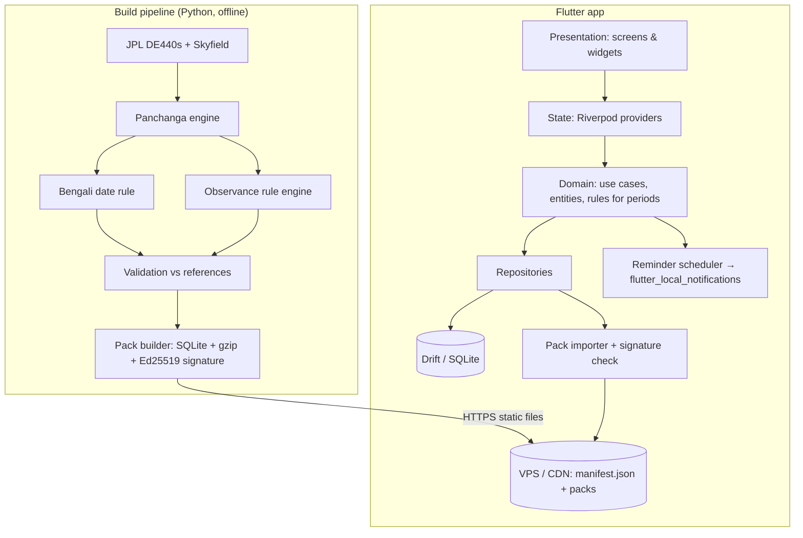

# Bangla Panjika App — Product Requirements Document (PRD)

| Field | Value |
|---|---|
| Product | বাংলা পঞ্জিকা (working name: "Panjika") |
| Company | Scaleroot |
| Document owner | Saurabh |
| Version | 1.2 (Complete draft for build; calendar rules pending expert sign-off) |
| Date | 12 Oct 2026 |
| Status | Draft. Calendar-convention sections need sign-off from a Bengali panjika expert before build of the data pipeline is finalised |
| Platforms | Android first (Flutter), iOS second |
| Primary market | West Bengal, India (Bengali-speaking Hindu households), plus the Bengali diaspora across India and abroad |
| Languages | **Bengali and English, both complete and first-class at launch** (Bengali is the default and the source language) |

### Change log

| Version | Changes |
|---|---|
| 1.2 | **Bilingual and UI quality pass.** English becomes a complete, first-class UI language rather than "optional" (§1, §2.2, §3.1 G6, §8.9, §13). New optional bilingual name display and in-app glossary (FR-SET-06/07). New persona for English-reading users (§4.1). English wireframes for Onboarding and Today (§11.1, §11.2). Design system extended with per-script type scale, spacing/shape/motion tokens, adaptive layout, Bengali text-rendering rules and a UI quality bar (§12). Accessibility fix: light-mode `haldi` failed the 3:1 non-text contrast for the tithi ring, so a `haldi-strong` token was added, plus container colours for active/selected states (§12.2). Data model fixes: `pack_id` on every pack-delivered table, new `lunar_months` table (needed for lunar month names and মলমাস), observance windows split out because a nullable column cannot sit safely in a primary key, a fixed index-base convention, glosses on `names` (§15.1). Transition counts corrected (§6.2). Localisation tasks and checks added to the build plan (§22, §28). New open questions Q14 (English romanisation standard) and Q15 (language defaults) (§26). Glossary extended with English romanisation, yogas, karanas and periods (§27.1). |
| 1.1 | Complete draft for build. |

> **Data honesty rule for this whole document.** Every date, tithi time or festival shown in examples, wireframes and mockups is **sample data (নমুনা)** and is not a real religious date. Nothing in this PRD has been religiously verified.

> **How to use this document with Claude Code.** This PRD is the single source of truth. Put it in the repo as `docs/PRD.md` together with `CLAUDE.md` (delivered alongside). Build in the order given in **§28 Implementation guide**; every task there cites the requirement IDs (FR-…, US-…) it must satisfy. Anything marked **Q#** is an open decision for the human owner (§26) — the agent must not guess it.

---

## 1. Executive summary

Bengali families still buy a printed panjika every Chaitra, and the leading apps that try to replace it are trusted less than the paper. Public reviews of the market leaders complain about two things: **wrong dates** and **intrusive ads**. None of the apps reviewed clearly tells the user *which panjika tradition* its dates follow, even though West Bengal has two schools (Bishuddha Siddhanta and Surya Siddhanta / Gupta Press) that sometimes put the same festival on different days.

This product's position is simple: **the panjika you can trust, without the clutter.**

Three pillars:

1. **Trust.** Every screen states its tradition, location and time zone. Every festival carries a verification status. Data comes from a documented, reproducible astronomical pipeline that is validated against the Government of India's Rashtriya Panchang (Bengali edition) and a printed Bengali panjika before release.
2. **Bengali-first, truly bilingual daily use.** Native Bengali UI by default and an equally polished English UI (not a translation afterthought), Bengali numerals, traditional Bengali periods (বারবেলা, কালবেলা, অমৃতযোগ, মাহেন্দ্রযোগ) and large readable type for older users. An optional bilingual display shows panchanga names in both scripts, so an English reader can still match the printed panjika.
3. **Respectful monetization.** No interstitials, no app-open ads, no ads blocking content, nothing religious behind a paywall.

**Core technical idea:** compute astronomy *offline on a build server* with permissively licensed, high-precision tools, validate it, then ship it to phones as small **signed data packs** stored in SQLite. The phone reads data. It does not guess.

---

## 2. Problem and opportunity

### 2.1 Evidence from competitor research (public listings only, Oct 2026)

| App | Platform & scale | What it offers | What users complain about |
|---|---|---|---|
| Bangla Panjika Calendar 2026 (AppsDreamers) | Google Play, 1M+ installs, 4.4★ from 134K reviews, contains ads | Tithi, nakshatra, muhurat, Ekadashi for Smarta/Goswami/Nimbark, marriage dates, offline. Listing says Drik Siddhanta support is "coming soon" | Aug–Sep 2026 reviews: forced ~1-minute video ads before features, unskippable, users closing the app |
| Bengali Calendar 2026 Panjika (Anivale) | iOS, 4.2★ (225), ads + IAP (Kundli Pro ₹49–₹399) | Tithi, nakshatra, yoga, Rahu Kaal, muhurat tabs, horoscope, West Bengal temple list | "Shows wrong date, no connection with actual Bengali calendar" (2023); missing daily Bengali date (2020). Listing in English only. Declares location used for tracking |
| Bengali Calendar 2027 (Ramesh P) | iOS, 4.3★ (548), ads | Tithi, nakshatra, festivals incl. Islamic holidays, rashifal, 12/24 h toggle | ~20 seconds of ads on opening; "too much ad" |
| Bong Calendar (Outscar) | Android + iOS (iOS 2.3★, 3 ratings) | Lets the user choose Surya Siddhanta or Drik/Bishuddha; home-screen widgets | Too few reviews to judge |

Sources: the App Store and Google Play listing pages for each app, and APKMirror's copy of the Outscar description. Not verified: in-app UX, navigation and screenshots (no app was installed or tested).

**Other references found (not app-tested):**

| Type | Name | Relevance |
|---|---|---|
| Printed panjika | Bishuddha Siddhanta Panjika (since 1890) | Drik school; our MVP reference |
| Printed panjika | Gupta Press, P.M. Bagchi, Benimadhab Sil | Surya Siddhanta school; v1.1 reference |
| Government | Rashtriya Panchang (Positional Astronomy Centre, Kolkata; Bengali edition available) | Astronomical validation reference |
| Website | Drik Panchang (drikpanchang.com) | Popular all-India panchang site; documents regional sankranti rules |
| Website | Dekho Panchang (dekhopanchang.com) | Bengali calendar pages; contains at least one questionable claim (fixed month lengths), so not a reference |
| App | Bangla Calendar India (Outscar, iOS) | Offers both Surya and Drik schools |
| App | Bangla Calendar 2026 India (Asim Roy, iOS) | New, too few ratings to assess |

### 2.2 The gap

| Gap | Why it matters | Our answer |
|---|---|---|
| Tradition is hidden | Users see a "wrong" date when the app silently follows a different school from their family's panjika | Tradition chosen at onboarding, shown on every date screen |
| Ads block religious information | Users close the app before reaching the tithi | Ad rules in §20: never above the fold on Today, never full-screen |
| English-first listings and UI, or Bengali with poor English | Older users read Bengali comfortably and English less so; younger and diaspora users are often the reverse | Bengali by default; a complete, natively written English UI; optional bilingual name display (§13) |
| No provenance | Users cannot tell if a date was checked | Verification badge per observance, "তথ্যসূত্র" (sources) screen |
| Manual yearly data drops | Apps freeze when next year's data is late | Data packs cover many years ahead; festival packs ship before Chaitra |
| Bengal-specific periods often missing | Bengali households check বারবেলা/কালবেলা before travel or puja | Included in MVP once rule tables are verified (§6.5.9) |

---

## 3. Goals, non-goals and success metrics

### 3.1 Product goals (first 12 months after launch)

| # | Goal | Metric | Target (assumption, to be revisited) |
|---|---|---|---|
| G1 | Be correct | Tier-1 festival dates matching the chosen reference panjika | 100% before release; 0 unresolved correctness reports older than 72 h |
| G2 | Be a daily habit | D30 retention | ≥ 20% |
| G3 | Be pleasant | Play Store rating | ≥ 4.5★; < 2% of reviews mention ads |
| G4 | Be accessible | Screens usable at 200% system font scale | 100% of MVP screens |
| G5 | Be sustainable | Revenue covers hosting + one expert review cycle per year | See §20 scenarios |
| G6 | Be bilingual | Every MVP screen, notification, share card and store asset available in Bengali and English | 100% of strings in both ARB files (CI-enforced); both languages copy-reviewed by native speakers; < 1% of reviews mention language problems |

### 3.2 Non-goals for MVP

Kundli/horoscope generation, daily rashifal, matchmaking, astrologer consultation, social features, Bangladesh's revised calendar, Muslim/Christian calendars, user accounts, cloud sync, iOS launch (follows Android).

### 3.3 Guardrail metrics

Crash-free sessions ≥ 99.5%. Cold start to Today screen < 1.5 s on a ₹10k Android phone. App size < 30 MB. Battery: no background work except scheduled notifications.

---

## 4. Users

### 4.1 Personas

**Mamata, 62, Howrah — "the keeper of the panjika".** Buys Gupta Press every year. Checks tithi each morning, Ekadashi and Purnima for fasting, বারবেলা before travel. Uses a mid-range Android with large system font. Pain: apps disagree with her printed panjika and are full of ads. Needs: large type, Bengali, her panjika's tradition, no surprises.

**Arindam, 35, Bengaluru (from Kolkata) — "the long-distance son".** Wants Puja dates to plan leave and call home on the right day. Pain: has to ask his mother; apps feel spammy. Needs: festival list, reminders, IST and local-time clarity, sharing a festival card to family WhatsApp.

**Riya, 24, Siliguri — "the occasional checker".** Opens the app around Durga Puja, Saraswati Puja, Poila Boishakh. Needs: fast "when is X" answer, good-looking share cards, dark mode.

**Ananya, 17, Pune — "the second generation".** Grew up outside Bengal; speaks Bengali at home but reads it slowly. Sets the phone to English. Needs: an English UI that uses the real terms (Tithi, Ekadashi, Barabela) rather than vague translations, a short explanation of each term, and the Bengali names alongside so she can read them out to her grandmother. Pain: English panchang apps follow North Indian (purnimanta) conventions and miss Bengali festivals.

### 4.2 Jobs to be done

1. "When I wake up, tell me today's tithi and whether today has a fast or puja."
2. "Before I travel or start something, tell me the inauspicious periods today."
3. "Tell me when the next big festival is and remind me before it."
4. "When my printed panjika and the app disagree, show me why."
5. "When I read in English, use the real Bengali terms, explain them briefly, and show me the Bengali so I can match it with the printed panjika."

---

## 5. Calendar convention (the most important decision)

### 5.1 Concepts the product must keep separate

| Layer | What it is | Example | Who decides it |
|---|---|---|---|
| L0 Astronomy | Positions of Sun and Moon, rise/set times | Moon's longitude at 10:00 IST | Physics + ephemeris |
| L1 Panchanga elements | Tithi, nakshatra, yoga, karana, sankranti, derived from L0 by fixed formulas | Shukla Saptami ends 14:32 | Formula + ayanamsa + siddhanta choice |
| L2 Calendar convention | How a civil day gets a Bengali date | "25 Ashwin 1433" | Regional rule (Bengal midnight rule) |
| L3 Observance rules | Which day a festival falls on | Kali Puja = night where Amavasya prevails at midnight | Smriti rules (Raghunandana) as applied by a panjika house |
| L4 Editorial | The published decision, including exceptions | "Durga Ashtami: Monday" | The panjika publisher / expert |

The app must never merge these. Each layer has its own code module, its own data tables and its own tests.

### 5.2 The two schools in West Bengal

- **Drik / Bishuddha Siddhanta** (বিশুদ্ধ সিদ্ধান্ত পঞ্জিকা, first published 1890). Uses modern astronomical positions. Described as consistent with the Government of India's national Panchang method. Followed by Belur Math and Tarakeswar Math.
- **Adrik / Surya Siddhanta** (Gupta Press, P.M. Bagchi, Benimadhab Sil and others). Uses the classical Surya Siddhanta model with Raghunandana's rules. Historically the more popular almanac; the state government has followed Gupta Press for Puja holidays.

Because the day's tithi is judged at sunrise, a few minutes' difference in a tithi's end time can move a festival to a different day between the two schools.

### 5.3 Decision for MVP

| Item | Decision | Reason | Reversible? |
|---|---|---|---|
| Default tradition | **Drik (Bishuddha-aligned)** | Reproducible from modern astronomy; validatable against Rashtriya Panchang; matches Belur Math | Yes: tradition is a data dimension from day 1 |
| Second tradition | Surya Siddhanta (Gupta Press-aligned) in v1.1 | Large user base, but needs a separate computational model and a licensed or expert-verified reference | — |
| Ayanamsa | Lahiri (Chitrapaksha) | Used by the Indian Astronomical Ephemeris and Rashtriya Panchang | Config value |
| Time zone | IST (UTC+05:30), no DST | West Bengal | Per-city field |
| Day boundary | Sunrise to sunrise for panchanga purposes; midnight to midnight for the civil date | Standard Hindu practice | — |
| Reference location for festival decisions | **Open question Q1** (Kolkata vs. the publisher's own reference meridian) | Must match the panjika we validate against | — |
| Bengali date rule | Bengal midnight rule (§6.5.6) | Documented regional practice | — |
| Lunar month naming | Amanta (month ends at Amavasya) — **to confirm with expert (Q2)** | Bengal practice | — |

**User-facing honesty:** onboarding explains the two schools in two sentences and lets the user pick. Until Surya Siddhanta ships, selecting it shows "শীঘ্রই আসছে" (coming soon) and keeps Drik as active, with a clear note.

### 5.4 Things that are explicitly out of scope for the convention

Bangladesh's revised Bengali calendar (fixed month lengths, Poila Boishakh on 14 April), Tripura/Assam (Barak Valley) local variants, and Vaishnava (ISKCON/Gaudiya) observance calendars. The schema supports adding these later as new `tradition` values.

---

## 6. Data strategy (deep dive)

### 6.1 The core question: where does each number come from?

```
                ┌──────────────────────────────────────────────┐
  BUILD SERVER  │  L0 Ephemeris  →  L1 Panchanga  →  L2 Date   │   reproducible,
  (your VPS or  │  (Skyfield +      (tithi, naks.,   (Bengal     │   versioned,
   laptop, CI)  │   JPL DE440s)      yoga, karana,    midnight   │   tested
                │                    sankranti)       rule)      │
                │                         │                      │
                │              L3 Observance rule engine         │
                │                         │                      │
                │   L4 Validation: Rashtriya Panchang + printed  │
                │      panjika + expert sign-off → status flags  │
                └──────────────┬───────────────────────────────┘
                               │ signed data pack (SQLite, gzip, Ed25519)
                               ▼
  PHONE         ┌──────────────────────────────────────────────┐
                │ Drift DB ← pack importer (verify signature)   │
                │ Light on-device math: Rahu Kaal etc. from     │
                │ stored sunrise/sunset; formatting; reminders  │
                └──────────────────────────────────────────────┘
```

Why not compute everything on the phone? Three reasons: (1) licensing of the best phone-ready libraries is restrictive (Swiss Ephemeris), (2) one validated dataset is easier to trust and to correct than millions of phones each computing, and (3) observance decisions (L3/L4) need human review anyway.

### 6.2 Global vs. location-dependent values

This split keeps the data small.

| Value | Depends on location? | Storage |
|---|---|---|
| Tithi, nakshatra, yoga, karana start/end moments | **No** (an instant in UTC, shown in IST) | One global table |
| Sankranti (solar month ingress) moments | No | Global table |
| New/full moon, eclipses | No (visibility of eclipses does) | Global table |
| Sunrise, sunset, moonrise, moonset | **Yes** | Per city per day |
| Rahu Kaal, Yamaganda, Gulika, বারবেলা, কালবেলা | Yes (derived from sunrise/sunset) | Computed on phone from stored sunrise/sunset |
| Udaya tithi (tithi at sunrise) | Yes, slightly | Computed on phone from global transitions + city sunrise |
| Bengali civil date | No (rule uses IST midnight) for West Bengal | Global table per tradition |
| Festival date | Decided per tradition for a reference location, not per user city | Observance table per tradition |

**Size estimate.** Each year has roughly 371 tithi, 361 nakshatra (the Moon passes all 27 every 27.3 days), 388 yoga (Sun + Moon sum moves about 14.2° a day), 742 karana and 12 sankranti transitions: about 1,875 rows. 26 years (2020–2045) is about 49,000 rows, under 1 MB. Per-city rise/set data: 4 values × 366 days × 80 cities ≈ 117,000 values per year, about 0.5 MB per year compressed. Ship 3 years in the APK; download more on demand.

### 6.3 Options compared

| Option | What it is | Licence | Accuracy | Cost | Verdict |
|---|---|---|---|---|---|
| **Swiss Ephemeris** | Industry-standard astrology ephemeris (C) | AGPL-3.0 or paid Professional Licence; pricing not public | Excellent | Licence fee (unknown) | Do not ship in a closed-source app without the paid licence. Could be used internally only after legal review |
| **Skyfield + JPL DE440s** (Python) | Research-grade astronomy library + NASA JPL ephemeris | Skyfield is MIT; JPL ephemerides are generally treated as public domain — **confirm JPL terms** | Sub-arcsecond | Free | **Recommended for the build pipeline** |
| **Astronomy Engine** (Don Cross) | Compact Sun/Moon/planet library in C, C#, JS, Python | MIT | Within ±1 arcminute of NOVAS | Free | **Recommended for on-device** arbitrary-location rise/set (v1.1), via Dart FFI or a partial Dart port |
| `panchang` on PyPI (Rust core) | Open panchang library with Bengali solar calendar | **Licence not yet checked** | Claims minute-level match with Drik Panchang on its own samples | Free? | Useful as a *cross-check* only after licence review |
| Commercial APIs (Divine API, Prokerala, RoxyAPI, Astro Agents) | Panchang over HTTP | Proprietary ToS | Varies; unverified | Per call / subscription | Not for core data (online dependency, cost per user, opaque method). Possibly a third cross-check |
| **Rashtriya Panchang** (Positional Astronomy Centre, Kolkata, IMD) | Government annual panchang, published in Bengali too, e-version downloadable | Government publication — reuse terms **to confirm** | Modern scientific basis; Lahiri ayanamsa | Free/low | **Primary validation reference** for L1 (tithi/nakshatra/yoga times, sunrise for metros) |
| Indian Astronomical Ephemeris (same centre) | ~500-page annual astronomical ephemeris incl. Indian calendar section | Same | High | Low | Secondary validation reference |
| Printed Bishuddha Siddhanta Panjika | The tradition we follow | Copyright of publisher | Defines the "correct" answer for L3/L4 | ₹ price of a copy | **Primary validation reference for Bengali dates and festivals.** Use for checking, not for copying tables wholesale |
| Licensing deal with a panjika house | Official data partnership | Contract | Authoritative | Negotiated | **Best long-term trust signal** ("data verified with X Panjika"). Explore in v1.1 |

### 6.4 Recommended pipeline (concrete)

Location: `data/` folder of the monorepo (§28.1), Python 3.12, independent of the Flutter app.

```
data/
  ephem/            # downloads + checksums for de440s.bsp
  engine/
    astro.py        # Sun/Moon apparent sidereal longitude, rise/set
    ayanamsa.py     # Lahiri, documented formula + tests
    panchanga.py    # tithi/nakshatra/yoga/karana transition search
    solar.py        # sankranti search
    bengali.py      # Bengali civil date (midnight rule)
    observances/    # rule engine + YAML rules
  reference/        # hand-entered values from Rashtriya Panchang & printed panjika (private, not shipped)
  validate/         # comparison reports, tolerances, diff HTML
  pack/             # build SQLite pack, gzip, sign (Ed25519)
  tests/
```

Steps per release:

1. **Compute** L0–L2 for the year range (deterministic; same inputs → same bytes; record library versions and ephemeris checksum in the pack metadata).
2. **Compute** L3 observances from rules. Each output row starts with `status = computed`.
3. **Validate** against references (§6.7). Rows that match get `status = reference_matched`; any mismatch blocks the build until explained.
4. **Expert review** of tier-1 and tier-2 festivals; reviewer initials + date stored. Status becomes `expert_reviewed`.
5. **Pack, sign, publish** to static hosting (your existing VPS behind a CDN is enough). The app verifies the signature with an embedded public key before import. The pack builder refuses to build if any `names` or `observances` row lacks either its Bengali or its English text (FR-L10N-09).

### 6.5 Algorithms and rules

All angles are **sidereal** (nirayana) longitudes unless stated: λ_sid = λ_tropical − ayanamsa(t).

#### 6.5.1 Tithi
`elongation = (λ_moon − λ_sun) mod 360°`. Tithi number = `floor(elongation / 12°) + 1` (1–30). 1–15 are Shukla Paksha (15 = Purnima); 16–30 are Krishna Paksha (30 = Amavasya). Tithi is independent of ayanamsa because both longitudes shift equally.

Transition search: step through time in 1-hour increments; when the integer part of `elongation/12` changes, refine with bisection (or Brent's method) to 1-second precision. Moon–Sun elongation grows ~12.2°/day on average, so 1 arcminute of position error ≈ 2 minutes of time error. This is why the build pipeline uses a high-precision ephemeris.

Tithi length varies, roughly 19 to 27 hours. Tests assert every tithi length is within that band.

#### 6.5.2 Nakshatra
`index = floor(λ_moon_sid / 13°20′)` (0–26), pada = `floor((λ_moon_sid mod 13°20′) / 3°20′) + 1`.

#### 6.5.3 Yoga
`index = floor(((λ_sun_sid + λ_moon_sid) mod 360°) / 13°20′)` (0–26).

#### 6.5.4 Karana
`k = floor(elongation / 6°)` (0–59).
- k = 0 → কিংস্তুঘ্ন (Kimstughna)
- k = 57 → শকুনি, 58 → চতুষ্পদ, 59 → নাগ
- otherwise movable karana = `(k − 1) mod 7` over: বব, বালব, কৌলব, তৈতিল, গর, বণিজ, বিষ্টি (ভদ্রা)

#### 6.5.5 Sunrise / sunset / moonrise / moonset
Default definition: upper limb at the horizon with standard refraction (Sun altitude −0.8333°). Hindu panchangs sometimes use the centre of the disc; **this is a config flag validated against the reference panjika (Q3)**. Elevation ignored (cities ≤ 2,100 m; Darjeeling is the outlier — flag for review). Moonrise uses the Moon's topocentric position with parallax.

#### 6.5.6 Sankranti and the Bengali civil date
Sankranti = moment λ_sun_sid crosses a multiple of 30°. Mesha (0°) starts বৈশাখ; Vrisha → জ্যৈষ্ঠ; … Meena → চৈত্র.

**Bengal rule:** if the sankranti occurs between sunrise and midnight, the new month begins the following day; if it occurs after midnight, the month begins on the day after that.

Implementation detail to confirm with the expert (Q4): which "midnight" (civil 00:00 IST vs. local true midnight) and how a sankranti before sunrise is treated. Write the rule as a pure function with exhaustive tests around both edges.

Bengali year (Bangabda) = Gregorian year − 593 from Poila Boishakh onward, − 594 before it. Month lengths vary between 29 and 32 days; the app must never hard-code them.

#### 6.5.7 Udaya tithi, kshaya and vriddhi
- **Udaya tithi**: the tithi prevailing at local sunrise names the day.
- **Kshaya tithi**: a tithi that begins after one sunrise and ends before the next never touches a sunrise. The UI shows it as a second line on that day ("ক্ষয় তিথি").
- **Vriddhi tithi**: a tithi spanning two sunrises appears on both days.
- **Adhik / Mala masa (মলমাস)**: a lunar month with no sankranti. Festivals are not held in it; the rule engine must skip it.

#### 6.5.8 Rahu Kaal, Yamaganda, Gulika
Divide sunrise→sunset into 8 equal parts. Part number (1-based) by weekday:

| Day | Rahu Kaal | Yamaganda | Gulika |
|---|---|---|---|
| Sun | 8 | 5 | 7 |
| Mon | 2 | 4 | 6 |
| Tue | 7 | 3 | 5 |
| Wed | 5 | 2 | 4 |
| Thu | 6 | 1 | 3 |
| Fri | 4 | 7 | 2 |
| Sat | 3 | 6 | 1 |

This is the commonly published table; verify it against the reference before release.

#### 6.5.9 Bengal-specific periods (বারবেলা, কালবেলা, কালরাত্রি, অমৃতযোগ, মাহেন্দ্রযোগ)
These are what Bengali households actually look for, and the generic Rahu Kaal is less familiar. The rule tables (weekday → which division of day/night) differ in how they are presented across panjikas. **Do not invent them.** Transcribe the rule (not the daily output) from the expert, encode as data in `period_rules`, and validate the computed output against 30 sample days in the printed panjika. Until validated, these rows are hidden behind a feature flag.

#### 6.5.10 Time units
Traditional panjikas also print times in দণ্ড-পল from sunrise (1 দণ্ড = 24 minutes; 1 পল = 24 seconds). Offer as an optional display mode (v1.1). Also needed for some rules (e.g. Sandhi Puja spans the last 24 minutes of Ashtami and the first 24 minutes of Navami).

### 6.6 Observance rule engine

Festivals are **rules plus editorial overrides**, never a list of Gregorian dates. Rules live in YAML, one file per observance, reviewed like code.

```yaml
# observances/kali_puja.yaml   (DRAFT — needs expert review)
id: kali_puja
name_bn: কালীপূজা
name_en: Kali Puja
tier: 1
tradition: [drik_bishuddha]
lunar_month: kartika          # amanta naming, see Q2
tithi: amavasya
decision:
  type: prevails_at
  moment: nishita              # local midnight window
  location: reference          # see Q1
  tie_breaker: earlier_day
outputs:
  - kind: date
  - kind: window               # nishita puja window shown on day screen
review:
  status: draft
  reviewer: null
```

Supported decision types (initial set): `udaya` (tithi at sunrise), `prevails_at` (at a named moment: pratah, madhyahna, aparahna, pradosha, nishita), `sankranti_day`, `fixed_bengali_date` (e.g. 1 Boishakh), `ekadashi_smarta`, `ekadashi_vaishnava` (v1.1), `span` (multi-day: Durga Puja Shashthi→Dashami), and `override` (editorial date set by reviewer, with a mandatory reason).

Each festival declares **which windows** it outputs (e.g. Durga Ashtami: Sandhi Puja window; Lakshmi Puja: Purnima window). The engine never outputs a festival without a tradition and a status.

Tier list for MVP:

| Tier | Observances | Validation level |
|---|---|---|
| 1 | Poila Boishakh, Durga Puja (Mahalaya, Shashthi→Dashami, Sandhi Puja), Lakshmi Puja (Kojagari), Kali Puja/Diwali, Saraswati Puja, Janmashtami, Rath Yatra, Shivaratri, Dol Purnima | Reference match **and** expert review |
| 2 | All Ekadashi, Purnima, Amavasya, Sankranti, Jamai Shashthi, Bhai Phonta, Vishwakarma Puja, Annapurna Puja, Manasa Puja, Jagaddhatri Puja, Ram Navami | Reference match |
| 3 | Rabindra Jayanti, Netaji Jayanti and other civil/cultural days | Source citation |

### 6.7 Validation plan

| Check | Reference | Sample | Tolerance | Blocks release? |
|---|---|---|---|---|
| Tithi end times | Rashtriya Panchang (Bengali ed.) | Every tithi of 3 months spread over the year + all tithis near Durga Puja | ±2 min | Yes |
| Nakshatra / yoga end times | Rashtriya Panchang | Same | ±2 min | Yes |
| Sunrise / sunset Kolkata | Rashtriya Panchang + Indian Astronomical Ephemeris | 24 days (2 per month) | ±1 min | Yes |
| Sunrise other cities | Independent computation (Astronomy Engine) | 10 cities × 12 days | ±1 min | Yes |
| Bengali date | Printed Bishuddha panjika | **Every day** of 1433 and 1434 BS | Exact | Yes |
| Month start days | Printed panjika | All 24 sankrantis | Exact | Yes |
| Tier-1 festival dates | Printed panjika + expert | All | Exact | Yes |
| Tier-2 dates | Printed panjika | All | Exact | Yes (or hidden) |
| Bengal periods | Printed panjika | 30 days | Exact window | Feature-flagged until pass |

Every validation run produces an HTML diff report kept in `validate/reports/`. A mismatch is never "fixed" by editing output data; it is fixed by changing a rule, a config value or an override with a written reason.

### 6.8 Verification status model (shown to users)

| Status | Bengali label | English label | Meaning | Shown how |
|---|---|---|---|---|
| `computed` | গণনাকৃত | Computed | Computed by rules, not yet checked | Grey dot; not allowed for tier 1 in production |
| `reference_matched` | পঞ্জিকা মিলিয়ে দেখা | Checked with panjika | Matches the printed reference | Green tick |
| `expert_reviewed` | বিশেষজ্ঞ যাচাইকৃত | Expert reviewed | Reviewed by named expert | Green double tick |
| `sample` | নমুনা তথ্য | Sample data | Test fixture | Diagonal "নমুনা · SAMPLE" watermark on screen; only in debug builds |
| `stale` | তথ্য পুরনো | Data out of date | Pack older than its validity window | Amber banner |

### 6.9 Yearly data-operations calendar

Printed panjikas usually come out in Chaitra, ahead of Poila Boishakh. Plan:

| When | Task |
|---|---|
| Magh–Falgun (Jan–Feb) | Compute next Bengali year; generate draft observances |
| Chaitra (Mar–Apr), as soon as printed panjika is out | Validate Bengali dates and festivals against it; expert review |
| Before 1 Boishakh | Publish signed pack; push "new year data ready" in-app notice |
| Bhadra (Aug–Sep) | Re-check Durga Puja → Kali Puja season; publish correction pack if needed |
| Any time | Correction pack within 72 h of a confirmed error report |

### 6.10 Legal notes on data (not legal advice — get a lawyer's view before launch)

- Astronomical facts and festival dates are facts; copying a publisher's typeset tables, layout, text or artwork is not acceptable. Use printed panjikas to **check** our computed output.
- Do not claim affiliation with Belur Math, Gupta Press or any publisher without a written agreement.
- Swiss Ephemeris: its licence contract treats an app that calls a server running it as an app containing it. Avoid it entirely unless a professional licence is purchased.
- Keep a `THIRD_PARTY_NOTICES` file listing every library, font and dataset with its licence.

---

## 7. Scope by release

| Feature | MVP (v1.0) | v1.1 | v2 | Never / out |
|---|---|---|---|---|
| Today screen with full daily panjika | ✅ | | | |
| Monthly calendar (Bengali + Gregorian) | ✅ | | | |
| Day detail | ✅ | | | |
| Festival list, month filter, details | ✅ | | | |
| City picker (West Bengal + metros) | ✅ | | | |
| Device location → nearest supported city | ✅ | | | |
| Exact-coordinate on-device rise/set | | ✅ | | |
| Offline data (3 years bundled) | ✅ | | | |
| Festival + tithi reminders (Ekadashi, Purnima, Amavasya) | ✅ | | | |
| Custom reminders | | ✅ | | |
| Share festival card (image) | ✅ | | | |
| Search by Bengali / Gregorian date | ✅ | | | |
| Bengali + English UI, both complete (§13) | ✅ | | | |
| Bilingual name display (both scripts) | ✅ | | | |
| In-app glossary (শব্দকোষ / Glossary) | ✅ | | | |
| Dark mode, text size control | ✅ | | | |
| Adaptive layout (phone portrait + landscape, large text) | ✅ | | | |
| Two-pane tablet / foldable layout | | ✅ | | |
| Hindi or other UI languages | | | ✅ (architecture allows it; no MVP work) | |
| Bengal periods (বারবেলা etc.) | ✅ behind flag until validated | | | |
| Surya Siddhanta / Gupta Press tradition | | ✅ | | |
| দণ্ড-পল time display | | ✅ | | |
| Home-screen widget (Android) | | ✅ | | |
| Marriage / Griha Pravesh / Annaprashan dates | | | ✅ (only from licensed or expert data) | |
| Daily rashifal | | | ✅ optional, clearly labelled entertainment | |
| Bangladesh calendar | | | ✅ | |
| Kundli generation, paid astrologer chat | | | | ❌ |
| Paywalled religious data | | | | ❌ |

---

## 8. Functional requirements

IDs are referenced by tests and tickets.

### 8.1 Today (আজ)
- **FR-HOME-01** Show Gregorian date, weekday, Bengali date (day, month, year) in Bengali numerals.
- **FR-HOME-02** Show current tithi with paksha, end time, and progress through the tithi. If the tithi changes later today, show the next tithi and its start.
- **FR-HOME-03** Show nakshatra, yoga, karana with end times.
- **FR-HOME-04** Show sunrise, sunset, moonrise, moonset for the selected city; label city and "IST".
- **FR-HOME-05** Show today's observances with verification badge.
- **FR-HOME-06** Show the next 3 upcoming tier-1/2 observances with "N দিন বাকি".
- **FR-HOME-07** Show today's inauspicious and auspicious periods; highlight the one currently active.
- **FR-HOME-08** Update automatically when the app is open across a tithi transition, sunrise, or midnight.
- **FR-HOME-09** If data for today is missing or stale, show an explicit state (§11.9), never placeholder numbers.

### 8.2 Calendar (মাস)
- **FR-CAL-01** Month grid with both Bengali and Gregorian day numbers in each cell.
- **FR-CAL-02** Two modes: Bengali month view (default; e.g. আশ্বিন ১৪৩৩) and Gregorian month view. A segmented control switches modes and keeps the selected day.
- **FR-CAL-03** Swipe and arrow buttons for previous/next month; tap the title to jump to any month/year.
- **FR-CAL-04** Cell markers: Purnima (filled circle), Amavasya (hollow circle), Ekadashi (small "এ"), festival (colour bar), today (ring), selected (fill). Legend reachable from the header.
- **FR-CAL-05** Tap a day → Day detail. Long-press → quick peek sheet.
- **FR-CAL-06** Bengali month grids start on the 1st of the Bengali month, which may fall mid-Gregorian-month; month lengths 29–32 come from data.
- **FR-CAL-07** "আজ" button returns to today.

### 8.3 Day detail (দিন)
- **FR-DAY-01** Everything from FR-HOME-02..07 for any date.
- **FR-DAY-02** Show kshaya/vriddhi tithi information when applicable.
- **FR-DAY-03** Show Rahu Kaal, Yamaganda, Gulika, and validated Bengal periods as time ranges.
- **FR-DAY-04** Footer: tradition, city, coordinates, time zone, data-pack version, verification status.
- **FR-DAY-05** Previous/next day by swipe.
- **FR-DAY-06** Share day summary as an image.

### 8.4 Festivals (পার্বণ)
- **FR-FEST-01** Year list grouped by Bengali month, with Gregorian date.
- **FR-FEST-02** Filters: month, category (পূজা, ব্রত/উপবাস, তিথি, উৎসব, জয়ন্তী), tier.
- **FR-FEST-03** Festival detail: short description (original text, written by us), date(s), relevant windows (e.g. Sandhi Puja), tithi involved, status, reminder toggle, share.
- **FR-FEST-04** Multi-day festivals show each day (e.g. Durga Puja Shashthi→Dashami).

### 8.5 Location
- **FR-LOC-01** Manual city picker with search in Bengali and English (e.g. "হাওড়া", "howrah").
- **FR-LOC-02** "Use my location" requests coarse location only after the user taps it; maps to nearest supported city and shows the distance ("নিকটতম শহর: বর্ধমান, ১২ কিমি").
- **FR-LOC-03** If the nearest city is > 50 km away, show a warning that timings may differ by a few minutes.
- **FR-LOC-04** Denied permission never blocks the app; Kolkata is the default.
- **FR-LOC-05** After a city change, show a one-time toast listing what changed ("সূর্যোদয় ও রাহুকাল বদলেছে; তিথি ও উৎসবের তারিখ একই").

### 8.6 Reminders
- **FR-REM-01** Per-festival reminder: day before at 20:00 and/or morning of at 06:00 (defaults editable).
- **FR-REM-02** Recurring: every Ekadashi / Purnima / Amavasya, with an option "at tithi start" or "morning of udaya day".
- **FR-REM-03** Reminders are scheduled locally for the next 60 days and rescheduled on app open, data-pack update, city change, and device reboot.
- **FR-REM-04** Notification text in the UI language, e.g. "আগামীকাল একাদশী। তিথি শুরু রাত ৯:১৪" / "Ekadashi tomorrow. Tithi begins 9:14 PM" (sample).

### 8.7 Search
- **FR-SRCH-01** Search by Gregorian date ("12/10/2026"), Bengali date ("২৫ আশ্বিন ১৪৩৩"), or festival name in either script.

### 8.8 Settings & trust
- **FR-SET-01** Language, tradition, city, theme, text size, 12/24 h, numeral style (Bengali/Latin).
- **FR-SET-02** "তথ্যসূত্র ও যাচাই" (Sources & verification) screen: explains tradition, pipeline, references, pack versions, last validation date.
- **FR-SET-03** "ভুল জানান" (Report an error): pre-filled form with date, city, tradition, pack version and a free-text field; works offline (queued).
- **FR-SET-04** Remove ads (premium purchase / restore).
- **FR-SET-05** Changing language applies instantly to every screen without restarting the app or losing navigation state, and re-localises scheduled notifications (§17).
- **FR-SET-06** "নাম দুই লিপিতে" / "Names in both scripts": when on, panchanga names, Bengali dates and festival names show the other script as a smaller second line (§13.4).
- **FR-SET-07** Glossary (শব্দকোষ / Glossary): every panchanga term and period with a 1–2 sentence plain-language explanation in the UI language. Terms on Today and Day detail open their glossary entry on long-press or via an (i) affordance.

### 8.9 Localisation (both languages)
- **FR-L10N-01** Two complete UI languages: বাংলা (`bn`, source) and English (`en`, written for Indian English, `en-IN` conventions). No screen, dialog, toast, error, notification, share card, semantics label or store asset may exist in only one language.
- **FR-L10N-02** First launch picks the language from the device locale (`bn*` → বাংলা; anything else → see Q15) and the onboarding language step confirms it. The choice is stored in-app and is independent of the device locale afterwards.
- **FR-L10N-03** Android 13+: the language also appears in system Settings → App languages (per-app language preference, `locales_config.xml`); a change made there is reflected in the app and vice versa.
- **FR-L10N-04** Numeral style (Bengali ০–৯ / Latin 0–9) is a separate setting from language. Defaults: Bengali UI → Bengali numerals; English UI → Latin numerals.
- **FR-L10N-05** Panchanga names in English use romanised Indic terms (Shukla Saptami, Nakshatra, Barabela) from the `names` table, never invented English translations ("seventh waxing lunar day") as primary labels. Meanings appear in the glossary (FR-SET-07).
- **FR-L10N-06** Dates and times follow the formatting rules in §13.3 for each language, including English plural forms ("1 day left" / "3 days left") through ICU plural messages.
- **FR-L10N-07** Search accepts both scripts and both numeral systems whatever the UI language (FR-SRCH-01, §13.6).
- **FR-L10N-08** Screen-reader labels are in the UI language; in bilingual display mode the second-script line is either tagged with its locale or excluded from the label, so TalkBack never reads Bengali with an English voice (§13.7).
- **FR-L10N-09** The bundled pack carries both `name_bn` and `name_en` for every name and observance, and `description_bn` and `description_en` for every observance. A pack missing either language fails the build (§6.4 step 5).

---

## 9. User stories and acceptance criteria

**US-01 Today's tithi.** As Mamata, I want to see today's tithi in Bengali the moment I open the app.
- Given data for today exists, when I open the app, then the tithi name, paksha and end time are visible without scrolling on a 360×640 dp screen at 130% font scale.
- Given the tithi ends at 14:32 (sample), when the clock passes 14:32 with the app open, then the card switches to the next tithi within 60 s.
- Given today's data is missing, then I see "আজকের তথ্য পাওয়া যায়নি" with a "আবার চেষ্টা করুন" button, and no numbers.

**US-02 Tradition clarity.** As Mamata, I want to know which panjika the app follows so I can compare with mine.
- Every date screen footer shows the tradition name.
- The onboarding tradition step explains the two schools in ≤ 2 sentences each.

**US-03 Festival reminder.** As Arindam, I want a reminder before Kali Puja.
- When I tap "মনে করিয়ে দিন" on Kali Puja, then a notification permission prompt appears (Android 13+) only if not yet granted.
- Given permission is denied, then the toggle reverts and an inline message explains how to enable it.
- Given permission is granted, then a notification fires the evening before at the chosen time, in IST converted to device time.

**US-04 City change.** As Riya in Siliguri, I want sunrise for my city.
- When I pick শিলিগুড়ি, then sunrise/sunset/moonrise/moonset and Rahu Kaal update; tithi end times and festival dates do not change; a toast says so.

**US-05 Offline.** As any user, I want the app to work without internet.
- Given airplane mode and a fresh install, then Today, Calendar, Day and Festivals work for every date covered by the bundled pack (3 Bengali years).
- Given a date outside the bundled range, then the app says the data isn't downloaded and offers download when online.

**US-06 Calendar markers.** As Mamata, I want to spot Ekadashi and Purnima at a glance.
- Purnima, Amavasya and Ekadashi markers are distinguishable by shape, not only colour (colour-blind safe).
- The legend is reachable in one tap from the calendar header.

**US-07 Report an error.** As any user, if a date looks wrong, I want to tell the team.
- The report form pre-fills date, city, tradition and pack version; submitting offline queues it and shows "পাঠানো হবে".

**US-08 Accessibility.** As a TalkBack user, I want the calendar announced properly.
- Each day cell announces e.g. "সোমবার, ১২ অক্টোবর, ২৫ আশ্বিন, শুক্লা সপ্তমী, দুর্গাষষ্ঠী" (sample).
- In English the same cell announces "Monday, 12 October, 25 Ashwin, Shukla Saptami, Durga Shashthi" (sample).

**US-09 English UI.** As Ananya, I want the whole app in English that still uses the real panjika terms.
- Given the device language is English, when I open the app for the first time, then onboarding starts in English with Bengali one tap away.
- Every screen, notification and share card is in English; no Bengali-only string appears except panchanga names when "Names in both scripts" is on.
- Tithi, nakshatra, yoga, karana and periods use romanised terms ("Shukla Saptami", "Barabela"); long-press on a term opens its glossary entry.
- At 130% font scale on a 360×640 dp screen, the English tithi seal shows name, end time and next tithi without truncation or scrolling, just as in Bengali.

**US-10 Switching language.** As Arindam, I want to switch to Bengali to show my mother, then switch back.
- When I change the language in Settings, then the current screen re-renders in the new language within one frame, stays on the same screen and date, and the back stack is preserved.
- Pending reminders are re-localised; the next notification arrives in the new language.

**US-11 Both scripts.** As Ananya, I want to see the Bengali names under the English ones.
- When "Names in both scripts" is on, then tithi, nakshatra, Bengali date and festival names show a second line in Bengali script.
- The second line never pushes the tithi seal below the fold at 130% font scale; at 200% it wraps rather than truncates.

---

## 10. Information architecture

```
Onboarding (first run only)
  1 ভাষা (Language) → 2 পঞ্জিকা (Tradition) → 3 শহর (City) → 4 বিজ্ঞপ্তি (Notifications, optional)

Bottom navigation (4 tabs)            bn label      en label
  ├─ আজ        Today                  আজ           Today
  │    └─ Day detail (same component as Calendar → day)
  ├─ পঞ্জিকা     Calendar (month)       পঞ্জিকা        Calendar
  │    ├─ Day detail
  │    └─ Jump-to-month sheet, Legend sheet
  ├─ পার্বণ      Festivals              পার্বণ         Festivals
  │    └─ Festival detail → Reminder sheet, Share
  └─ আরও       More                   আরও          More
       ├─ অনুস্মারক   Reminders
       ├─ খুঁজুন      Search
       ├─ শহর        City
       ├─ শব্দকোষ     Glossary
       ├─ সেটিংস      Settings (language, names in both scripts, tradition, theme, text size, time format, numerals)
       ├─ তথ্যসূত্র ও যাচাই  Sources & verification
       ├─ ভুল জানান    Report an error
       ├─ বিজ্ঞাপন সরান  Remove ads
       └─ সম্পর্কে / গোপনীয়তা  About / Privacy
```

Navigation labels are always visible (never icon-only), in the UI language. A quick language switch (বাংলা | English) sits at the top of More as well as in Settings, because a shared family phone often changes hands.

Global elements: top bar shows **city chip** (tap → city picker) on Today, Calendar and Day screens.

---

## 11. Screen specifications

Wireframes are 360 dp wide. All example values are **নমুনা (sample)**.

### 11.1 Onboarding

```
┌──────────────────────────────┐
│        বাংলা পঞ্জিকা          │
│                              │
│  কোন পঞ্জিকা মেনে চলেন?        │
│ ┌──────────────────────────┐ │
│ │◉ বিশুদ্ধ সিদ্ধান্ত (দৃক)     │ │
│ │  আধুনিক জ্যোতির্বিজ্ঞান মতে।   │ │
│ │  বেলুড় মঠ এই মত মানে।        │ │
│ └──────────────────────────┘ │
│ ┌──────────────────────────┐ │
│ │○ গুপ্তপ্রেস (সূর্যসিদ্ধান্ত)   │ │
│ │  প্রাচীন পদ্ধতি। শীঘ্রই আসছে   │ │
│ └──────────────────────────┘ │
│  দুই মতে কখনো উৎসবের দিন আলাদা │
│  হয়। পরে সেটিংসে বদলাতে পারবেন। │
│                              │
│ [        এগিয়ে যান         ]   │
└──────────────────────────────┘
```

Language step (step 1), shown in both scripts at once because the user has not chosen yet:

```
┌──────────────────────────────┐
│          ● ○ ○ ○               │
│      ◐  বাংলা পঞ্জিকা           │
│         Bangla Panjika        │
│                              │
│  ভাষা বেছে নিন                  │
│  Choose your language         │
│ ┌──────────────────────────┐ │
│ │◉ বাংলা                    │ │  ← each option written in its own script
│ │  আজ শুক্লা সপ্তমী           │ │  ← live preview line (sample)
│ └──────────────────────────┘ │
│ ┌──────────────────────────┐ │
│ │○ English                  │ │
│ │  Today is Shukla Saptami  │ │
│ └──────────────────────────┘ │
│  পরে সেটিংসে বদলানো যাবে।       │
│  You can change this later.  │
│ [   এগিয়ে যান · Continue   ]   │
└──────────────────────────────┘
```

From step 2 onwards every screen is in the chosen language only. The same tradition step in English:

```
┌──────────────────────────────┐
│          ○ ● ○ ○               │
│  Which panjika do you follow?│
│ ┌──────────────────────────┐ │
│ │◉ Bishuddha Siddhanta (Drik)│ │
│ │  Based on modern astronomy.│ │
│ │  Followed by Belur Math.   │ │
│ └──────────────────────────┘ │
│ ┌──────────────────────────┐ │
│ │○ Gupta Press (Surya        │ │
│ │  Siddhanta) · Coming soon  │ │
│ │  The traditional method.   │ │
│ └──────────────────────────┘ │
│  The two can put a festival  │
│  on different days. You can  │
│  change this in Settings.    │
│ [         Continue         ]  │
└──────────────────────────────┘
```

- Steps: language → tradition → city → notifications (skippable). Progress dots at top.
- The language step defaults to the device locale (FR-L10N-02) and choosing the other option re-renders the step immediately, so the user sees the result before continuing.
- City step: search field, "আমার অবস্থান ব্যবহার করুন" button, list of popular cities.
- Notifications step: explains value ("একাদশী ও পূজার আগে মনে করিয়ে দেব"), then requests permission only on "চালু করুন".

### 11.2 Today (আজ) — the hero screen

```
┌──────────────────────────────┐
│ সোমবার        [📍 কলকাতা ▾]   │
│ ২৫ আশ্বিন ১৪৩৩                │  ← Bengali date, display size
│ ১২ অক্টোবর ২০২৬                │  ← Gregorian, secondary
│ ┌──────────────────────────┐ │
│ │   ◐  শুক্লা সপ্তমী          │ │  ← TITHI SEAL (the one bold element)
│ │      দুপুর ২:৩২ পর্যন্ত      │ │     moon arc = progress through tithi
│ │      তারপর অষ্টমী            │ │
│ └──────────────────────────┘ │
│  নক্ষত্র  মূলা · বিকেল ৪:১০ পর্যন্ত │
│  যোগ    শোভন · রাত ৮:০৫ পর্যন্ত  │
│  করণ    গর · দুপুর ২:৩২ পর্যন্ত   │
│ ──────────────────────────── │
│  ☀ ৫:৩৮  ☾ ৫:১৪   চাঁদ ↑১১:৫২ ↓১০:৪০│
│ ──────────────────────────── │
│  এখন: রাহুকাল ৭:৩২–৯:০০  ●     │  ← active period highlighted
│  বারবেলা ১০:৩০–১১:৫৮            │
│ ──────────────────────────── │
│  আজ  ▌দুর্গাষষ্ঠী  ✓✓          │
│ ──────────────────────────── │
│  আসছে                         │
│  ▌মহাষ্টমী        ২ দিন বাকি    │
│  ▌লক্ষ্মীপূজা       ৮ দিন বাকি    │
│ ──────────────────────────── │
│  দৃক (বিশুদ্ধ) · কলকাতা · IST     │
├──────────────────────────────┤
│  আজ   পঞ্জিকা   পার্বণ   আরও    │
└──────────────────────────────┘
```

The same screen in English, with "Names in both scripts" on (all values sample):

```
┌──────────────────────────────┐
│ Monday         [📍 Kolkata ▾] │
│ 25 Ashwin 1433                │  ← Bengali date stays the hero in English too
│ ২৫ আশ্বিন ১৪৩৩                 │  ← second script (only when the toggle is on)
│ 12 October 2026               │
│ ┌──────────────────────────┐ │
│ │   ◐  Shukla Saptami        │ │
│ │      শুক্লা সপ্তমী            │ │
│ │      until 2:32 PM         │ │
│ │      then Ashtami          │ │
│ └──────────────────────────┘ │
│  Nakshatra  Mula · until 4:10 PM│
│  Yoga       Shobhana · until 8:05 PM│
│  Karana     Gara · until 2:32 PM│
│ ──────────────────────────── │
│  ☀ 5:38 AM  ☾ 5:14 PM  Moon ↑11:52 AM ↓10:40 PM│
│ ──────────────────────────── │
│  Now: Rahu Kaal 7:32–9:00 AM ●│
│  Barabela 10:30–11:58 AM      │
│ ──────────────────────────── │
│  Today ▌Durga Shashthi  ✓✓    │
│ ──────────────────────────── │
│  Coming up                    │
│  ▌Maha Ashtami     in 2 days  │
│  ▌Lakshmi Puja     in 8 days  │
│ ──────────────────────────── │
│  Drik (Bishuddha) · Kolkata · IST│
├──────────────────────────────┤
│  Today  Calendar  Festivals  More│
└──────────────────────────────┘
```

English rows are longer than Bengali ones ("until 4:10 PM" vs "বিকেল ৪:১০ পর্যন্ত" is similar, but "Shobhana · until 8:05 PM" can wrap). PanchangRow therefore wraps the value under the label at narrow widths or large text instead of truncating.

Components: DateHeader, TithiSeal, PanchangRow ×3, TimingStrip, PeriodList, ObservanceChip, UpcomingFestivalCard, ProvenanceFooter.

Behaviour: pull-to-refresh only re-reads local data and checks for new packs. Tapping the tithi seal opens Day detail. Ad placement: none on this screen above the fold; at most one native ad card **below** the "আসছে" section (§20).

States: loading skeleton (≤ 300 ms, usually invisible), data missing (§11.9), stale pack (amber banner "তথ্য হালনাগাদ প্রয়োজন" + update button), sample build (diagonal watermark).

### 11.3 Calendar (পঞ্জিকা)

```
┌──────────────────────────────┐
│  ‹   আশ্বিন ১৪৩৩  ▾   ›   [আজ] │
│  [ বাংলা মাস | ইংরেজি মাস ]  (i) │
│ রবি  সোম  মঙ্গল বুধ  বৃহ  শুক্র শনি │
│ ┌───┬───┬───┬───┬───┬───┬───┐│
│ │   │   │   │ ১ │ ২ │ ৩ │ ৪ ││
│ │   │   │   │১৮ │১৯ │২০ │২১ ││  ← Gregorian small, below
│ ├───┼───┼───┼───┼───┼───┼───┤│
│ │ ৫ │ ৬ │ ৭ │ ৮ │ ৯ │১০ │১১ ││
│ │২২ │২৩ │২৪ │২৫ │২৬ │২৭ │২৮ ││
│ │   │ ● │   │   │ এ │   │   ││  ● Purnima  ○ Amavasya  এ Ekadashi
│ ├───┼───┼───┼───┼───┼───┼───┤│
│ │…  │   │   │   │   │   │   ││  ▌ coloured bar = festival
│ └───┴───┴───┴───┴───┴───┴───┘│
│  নির্বাচিত: ২৫ আশ্বিন            │
│  শুক্লা সপ্তমী · দুর্গাষষ্ঠী  [দেখুন]│  ← selected-day summary strip
├──────────────────────────────┤
│  আজ   পঞ্জিকা   পার্বণ   আরও    │
└──────────────────────────────┘
```

- Cell minimum 48×56 dp. Sundays' numerals in red (traditional), but never colour-only information.
- Below the grid: selected-day summary strip with a "দেখুন" (view) button.
- Year transition: swiping past চৈত্র goes to বৈশাখ of next year; title animates the year change.

### 11.4 Day detail (দিন)
Wireframe: §11.10.

Sections in order: date header → tithi (with kshaya/vriddhi line) → nakshatra/yoga/karana → sun & moon → শুভ সময় (auspicious) → অশুভ সময় (Rahu Kaal, Yamaganda, Gulika, বারবেলা, কালবেলা, কালরাত্রি) → observances → provenance footer. Each time row: label left, time range right, active row highlighted. Share button in app bar.

### 11.5 Festivals (পার্বণ)

```
┌──────────────────────────────┐
│ পার্বণ ১৪৩৩         [🔍]       │
│ [সব] [পূজা] [ব্রত] [তিথি] [উৎসব] │  ← filter chips
│ ── আশ্বিন ─────────────────── │
│ ▌দুর্গাষষ্ঠী   সোম, ১২ অক্টো  ✓✓ 🔔│
│ ▌মহাসপ্তমী   মঙ্গল, ১৩ অক্টো ✓✓  │
│ ▌মহাষ্টমী    বুধ, ১৪ অক্টো  ✓✓ 🔔│
│ ── কার্তিক ────────────────── │
│ ▌কালীপূজা    …                │
└──────────────────────────────┘
```

Sticky month headers; list auto-scrolls to the current month. Badge: ✓ reference matched, ✓✓ expert reviewed.

### 11.6 Festival detail
Wireframe: §11.11.
Hero band in the festival's category colour; name in the UI language (display) with the other script below it (always shown here, regardless of FR-SET-06); date(s); relevant windows (e.g. সন্ধিপূজা ০০:০০–০০:৪৮, sample); tithi involved and its span; 80–150-word original description; verification card ("বিশুদ্ধ সিদ্ধান্ত পঞ্জিকার সঙ্গে মিলিয়ে দেখা হয়েছে, চৈত্র ১৪৩২"); buttons: মনে করিয়ে দিন, শেয়ার করুন.

### 11.7 City picker
Wireframe: §11.12.
Search field (Bengali/English, transliteration-tolerant: "bardhaman", "burdwan", "বর্ধমান"); "আমার অবস্থান" row; sections: সাম্প্রতিক (recent), পশ্চিমবঙ্গ (by district), অন্যান্য শহর (metros). Each row shows district and today's sunrise for that city, which helps users understand why city matters.

### 11.8 Share card (image, 1080×1350)
Festival name in display Bengali type, date in both calendars, a simple original motif (alpona-inspired linework, drawn by us), app name and small "বিশুদ্ধ সিদ্ধান্ত মতে". No QR code clutter; optional store link in the share text.

Language: the share sheet offers **বাংলা**, **English** and **দুই ভাষায় / Both** (Bengali name as the hero with the English name below), defaulting to the UI language. Family WhatsApp groups often mix readers of both scripts. The card text, the share-message text and the provenance line ("As per Bishuddha Siddhanta") all follow the chosen option. Cards render at a fixed 1080×1350 regardless of the device text scale, and each layout is golden-tested in both languages with the longest festival name in the catalogue.

### 11.9 System states (applies to every data screen)

| State | Copy (Bengali) | Copy (English) | Action (bn / en) |
|---|---|---|---|
| Data not downloaded for this range | এই সময়ের তথ্য ডাউনলোড করা নেই। | Data for these dates isn't downloaded yet. | ডাউনলোড করুন / Download |
| Offline + not downloaded | ইন্টারনেট সংযোগ নেই। সংযোগ পেলে তথ্য ডাউনলোড হবে। | You're offline. The data will download when you're connected. | — |
| Pack stale | তথ্য হালনাগাদ প্রয়োজন। | This data needs an update. | হালনাগাদ করুন / Update |
| Signature failed | তথ্য যাচাই করা যায়নি, তাই দেখানো হচ্ছে না। | We couldn't verify this data, so it isn't shown. | আবার চেষ্টা করুন / Try again |
| Festival unverified (tier 2/3) | এই তারিখ এখনও পঞ্জিকা মিলিয়ে দেখা হয়নি। | This date hasn't been checked against the panjika yet. | — |

All other copy in this document is given in Bengali (the source language). Each string gets an English counterpart in `app_en.arb`, written to the voice rules in §13.2. English copy here is a draft for review, like the Bengali.

### 11.10 Day detail — wireframe

```
┌──────────────────────────────┐
│ ‹ পঞ্জিকা            [শেয়ার]   │
│ মঙ্গলবার                       │
│ ১৮ আশ্বিন ১৪৩৩                │
│ ৫ অক্টোবর ২০২৬                 │
│ ── তিথি ──────────────────── │
│ তিথি     পূর্ণিমা               │
│          রাত ৯:১৪ পর্যন্ত,       │
│          তারপর কৃষ্ণা প্রতিপদ     │
│ ক্ষয় তিথি  (শুধু প্রযোজ্য হলে)   │
│ পক্ষ     শুক্লপক্ষ               │
│ নক্ষত্র    রেবতী · …পর্যন্ত       │
│ যোগ      ধ্রুব · …পর্যন্ত        │
│ করণ      বিষ্টি                 │
│ ── সূর্য ও চন্দ্র ────────────── │
│ সূর্যোদয় / সূর্যাস্ত   ৫:৪০ / ৫:১১ │
│ চন্দ্রোদয় / চন্দ্রাস্ত  ৫:২২ / ৫:৫০ │
│ ── শুভ সময় ───────────────── │
│ অমৃতযোগ   …   মাহেন্দ্রযোগ …    │
│ ── অশুভ সময় ──────────────── │
│ রাহুকাল · যমগণ্ড · গুলিক · বারবেলা│
│ কালবেলা · কালরাত্রি              │
│ ── উৎসব ও ব্রত ────────────── │
│ ▌কোজাগরী লক্ষ্মীপূজা  ✓✓         │
│ ──────────────────────────── │
│ বিশুদ্ধ সিদ্ধান্ত · কলকাতা · IST    │
│ তথ্য v৩ · যাচাই: পঞ্জিকা মিলিয়ে দেখা │
└──────────────────────────────┘
```
Swipe left/right = next/previous day. Times that fall after midnight show "(পরদিন)".

### 11.11 Festival detail — wireframe

```
┌──────────────────────────────┐
│ ‹ পার্বণ                       │
│▓▓▓▓▓▓▓▓▓▓▓▓▓▓▓▓▓▓▓▓▓▓▓▓▓▓▓▓▓▓│
│▓ মহাষ্টমী                      ▓│  ← category-colour band
│▓ বুধবার, ১১ আশ্বিন ১৪৩৩           ▓│
│▓▓▓▓▓▓▓▓▓▓▓▓▓▓▓▓▓▓▓▓▓▓▓▓▓▓▓▓▓▓│
│ তিথি      অষ্টমী · …পর্যন্ত       │
│ সন্ধিপূজা   …–…                   │
│           অষ্টমীর শেষ ২৪ মিনিট ও   │
│           নবমীর প্রথম ২৪ মিনিট     │
│                              │
│ ছোট বিবরণ (৮০–১৫০ শব্দ, নিজেদের লেখা)│
│                              │
│ ┌✓✓ বিশুদ্ধ সিদ্ধান্ত পঞ্জিকার সঙ্গে  ┐│
│ │   মিলিয়ে দেখা ও বিশেষজ্ঞ যাচাইকৃত।  ││
│ └   যাচাই: চৈত্র ১৪৩২             ┘│
│ [ মনে করিয়ে দিন ] [ শেয়ার করুন ]  │
└──────────────────────────────┘
```
Multi-day festivals (Durga Puja) show a horizontal day selector (ষষ্ঠী · সপ্তমী · অষ্টমী · নবমী · দশমী) under the band.

### 11.12 City picker — wireframe

```
┌──────────────────────────────┐
│ ‹ শহর বেছে নিন                 │
│ [🔍 শহরের নাম লিখুন ………… ]      │
│ ◎ আমার অবস্থান ব্যবহার করুন       │
│ ── সাম্প্রতিক ─────────────── │
│ কলকাতা           সূর্যোদয় ৫:৩৮ ✓ │
│ ── পশ্চিমবঙ্গ ─────────────── │
│ হাওড়া   · হাওড়া    সূর্যোদয় ৫:৩৯ │
│ বর্ধমান · পূর্ব বর্ধমান  সূর্যোদয় ৫:৪২│
│ শিলিগুড়ি · দার্জিলিং  সূর্যোদয় ৫:৩৪ │
│ …                            │
│ ── অন্যান্য শহর ───────────── │
│ দিল্লি · মুম্বই · বেঙ্গালুরু · চেন্নাই …  │
└──────────────────────────────┘
```
Location result sheet: "নিকটতম শহর: বর্ধমান (১২ কিমি)। [এটি বেছে নিন] [অন্য শহর]". If > 50 km: extra line "সময় কয়েক মিনিট আলাদা হতে পারে।"
Permission denied: inline note "অবস্থানের অনুমতি দেওয়া হয়নি। তালিকা থেকে শহর বেছে নিন।" — no repeated prompts.

### 11.13 Reminders (অনুস্মারক) — wireframe

```
┌──────────────────────────────┐
│ ‹ অনুস্মারক                    │
│ ── নিয়মিত ────────────────── │
│ একাদশী                    [●] │
│   আগের দিন রাত ৮টা ▾           │
│ পূর্ণিমা                    [○] │
│ অমাবস্যা                   [○] │
│ ── উৎসব ───────────────────  │
│ কালীপূজা   আগের দিন রাত ৮টা   [●]│
│ লক্ষ্মীপূজা  সকাল ৬টা         [●]│
│ [+ উৎসব যোগ করুন]               │
│ ── নিজের অনুস্মারক (v1.1) ──── │
│ ──────────────────────────── │
│ বিজ্ঞপ্তি বন্ধ আছে? [সেটিংস খুলুন]   │  ← only if OS permission off
└──────────────────────────────┘
```
Timing options: আগের দিন (time picker), সেদিন সকালে (time picker), তিথি শুরুর সময় (only if exact alarms allowed — §17).
Empty state: "এখনো কোনো অনুস্মারক নেই। একাদশী বা কোনো উৎসবের জন্য চালু করুন।"

### 11.14 Search (খুঁজুন) — wireframe

```
┌──────────────────────────────┐
│ ‹ [🔍 তারিখ বা উৎসবের নাম ……]   │
│ উদাহরণ: ২৫ আশ্বিন ১৪৩৩ ·          │
│         12/10/2026 · কালীপূজা    │
│ ── ফলাফল ────────────────── │
│ 📅 ২৫ আশ্বিন ১৪৩৩ = ১২ অক্টোবর   │
│ ▌কালীপূজা  ১৪৩৩               │
│ ▌কালীপূজা  ১৪৩৪               │
└──────────────────────────────┘
```
Date results open Day detail; festival results open Festival detail. Out-of-range dates show the "not downloaded" state (§11.9). No results: "কিছু পাওয়া যায়নি। বানান বা তারিখের ধরন দেখে নিন।"

### 11.15 Settings (সেটিংস) — wireframe

```
┌──────────────────────────────┐
│ ‹ সেটিংস                      │
│ ভাষা          [বাংলা | English]│  ← segmented, each label in its own script
│ নাম দুই লিপিতে              [○] │  ← FR-SET-06, preview line below
│ পঞ্জিকার মত      বিশুদ্ধ সিদ্ধান্ত ▾│
│ শহর                 কলকাতা ›  │
│ থিম          স্বয়ংক্রিয় / হালকা / গাঢ় │
│ লেখার আকার      [অ ─●──── অ]   │  ← preview line below slider
│ সময়ের ধরন         ১২ ঘণ্টা ▾    │
│ সংখ্যা            বাংলা (১২৩) ▾  │
│ ── তথ্য ─────────────────── │
│ তথ্য হালনাগাদ      এখন দেখুন ›   │
│ ডাউনলোড করা বছর    ১৪৩২–১৪৩৫ ›   │
│ ── অন্যান্য ───────────────── │
│ বিজ্ঞাপন সরান ›  · গোপনীয়তা ›      │
│ লাইসেন্স ›  · সম্পর্কে ›           │
└──────────────────────────────┘
```
Changing tradition shows a confirm sheet: "পঞ্জিকার মত বদলালে কিছু উৎসবের তারিখ বদলাতে পারে। অনুস্মারক নতুন করে সাজানো হবে।" [বদলান] [থাক]
"লাইসেন্স" opens Flutter's `showLicensePage` plus our data/font notices.

### 11.16 Sources & verification (তথ্যসূত্র ও যাচাই) — wireframe

```
┌──────────────────────────────┐
│ ‹ তথ্যসূত্র ও যাচাই              │
│ আমরা কীভাবে হিসাব করি            │
│ ১ জ্যোতির্বিজ্ঞানের হিসাব (NASA JPL)│  ← genuine sequence, so numbered
│ ২ রাষ্ট্রীয় পঞ্চাঙ্গের সঙ্গে মিলানো    │
│ ৩ মুদ্রিত পঞ্জিকার সঙ্গে মিলানো      │
│ ৪ প্রধান উৎসব বিশেষজ্ঞের যাচাই      │
│ ── চিহ্নের অর্থ ─────────────── │
│ ✓✓ বিশেষজ্ঞ যাচাইকৃত               │
│ ✓  পঞ্জিকা মিলিয়ে দেখা              │
│ ●  শুধু গণনাকৃত                    │
│ ── এই ফোনের তথ্য ───────────── │
│ গ্লোবাল v৩ · শহর v২ · উৎসব v৪       │
│ শেষ যাচাই: চৈত্র ১৪৩২              │
│ দুই মত কেন আলাদা? ›               │
│ [ ভুল জানান ]                     │
└──────────────────────────────┘
```
"দুই মত কেন আলাদা?" opens a 150-word plain-language explainer about Drik vs Surya Siddhanta.

### 11.17 Report an error (ভুল জানান) — wireframe

```
┌──────────────────────────────┐
│ ‹ ভুল জানান                    │
│ কোন তারিখ?     ১১ আশ্বিন ১৪৩৩ ▾ │
│ কী ভুল?  ○ তিথির সময় ○ উৎসবের দিন │
│          ○ বাংলা তারিখ ○ অন্য     │
│ আপনার পঞ্জিকায় কী আছে?            │
│ [ ……………………………………… ]         │
│ পঞ্জিকার নাম (ঐচ্ছিক) [……]         │
│ সঙ্গে যাবে: শহর, মত, তথ্যের সংস্করণ  │
│ [        পাঠান          ]        │
└──────────────────────────────┘
```
No name, phone or email requested. Offline: "ইন্টারনেট পেলে পাঠানো হবে।" Success: "পাঠানো হয়েছে। যাচাই করে প্রয়োজনে সংশোধন করা হবে।"

### 11.18 Remove ads / Premium (বিজ্ঞাপনমুক্ত) — wireframe

```
┌──────────────────────────────┐
│ ‹ বিজ্ঞাপনমুক্ত                  │
│ সব পঞ্জিকা তথ্য সবসময় বিনামূল্যে।   │
│ বিজ্ঞাপনমুক্ত নিলে পাবেন:           │
│ · কোনো বিজ্ঞাপন নেই               │
│ · নিজের অনুস্মারক (v1.1)           │
│ · অতিরিক্ত থিম ও শেয়ার কার্ড         │
│ [ ₹৯৯ / বছর ]  [ ₹১৯৯ একবারে ]    │  ← prices are assumptions (§20.3)
│ কেনা আছে? [পুনরুদ্ধার করুন]          │
└──────────────────────────────┘
```
The first line is a product promise and must stay true (§20.1).

---

## 12. Design system

### 12.1 Direction
"The printed panjika, made calm." Bengali almanacs are red-and-black on paper with dense tables. We keep the **ink colours and Bengali typography**, drop the density, and spend boldness in exactly one place: the **tithi seal** on Today — a large tithi name inside a thin moon-phase ring that fills as the tithi progresses.

Design principles (use them to settle design arguments):

1. **One bold element per screen.** Today: the tithi seal. Calendar: today's ring. Festival detail: the category band. Everything else is quiet.
2. **Answer first.** What the user opened the screen for is readable without scrolling at 130% text on a 360×640 dp phone, in both languages.
3. **Calm density.** Keep the panjika's information and lose its clutter. Group with whitespace and section headers, not boxes inside boxes.
4. **Both scripts are first-class.** Every layout is designed, reviewed and golden-tested in Bengali and English. Neither is fitted in afterwards.
5. **Trust is visible.** Provenance and verification status are part of the layout, not fine print.
6. **Kind to the eyes.** Large type, honest contrast, a real dark mode, and motion only when it carries meaning.

### 12.2 Colour tokens

| Token | Light | Dark | Use |
|---|---|---|---|
| `ink` | #1F1A3D (indigo ink) | #ECEAF7 | Primary text |
| `ink-muted` | #5B567A | #A9A5C4 | Secondary text, second-script line (§13.4) |
| `paper` | #FFFFFF | #15132B | Background |
| `paper-raised` | #F6F4FB | #1E1C38 | Section backgrounds |
| `alta` (sindoor red) | #B4232C | #F0707A | Festivals, Sundays, inauspicious |
| `haldi` (turmeric) | #E3A21A | #F2BE4E | Large decorative fills and glows only (light value is not a text or indicator colour) |
| `haldi-strong` | #B07607 | #F2BE4E | Tithi ring progress, today marker, focus ring |
| `durba` (grass green) | #2E7A4E | #6CC596 | Auspicious, verification ticks |
| `rule` | #E2DFEE | #2E2B4D | Dividers (decorative only) |
| `alta-container` | #FBE9EA | #4A1D26 | Background of the active inauspicious period row |
| `haldi-container` | #FCF1D6 | #3D3014 | Tithi seal background, "today" cell fill |
| `on-haldi-container` | #5C3D00 | #FFE3A3 | Text/icons on `haldi-container` when not `ink` |
| `durba-container` | #E3F2E9 | #173A2A | Background of the active auspicious period row, verification card |

Festival category colours (the coloured bar on chips and lists; always paired with the category's name or icon, never colour alone):

| Category | Token | Light | Dark |
|---|---|---|---|
| পূজা / Puja | `alta` | #B4232C | #F0707A |
| ব্রত/উপবাস / Vrata & fasts | `neel` | #3949AB | #9FA8DA |
| তিথি / Tithi | `haldi-strong` | #B07607 | #F2BE4E |
| উৎসব / Festival | `padma` | #AD1457 | #F48FB1 |
| জয়ন্তী / Jayanti | `ink-muted` | #5B567A | #A9A5C4 |

**Measured contrast (v1.2, WCAG 2.x formula).** Text on `paper` / `paper-raised`: `ink` 16.5/15.1 light, 15.2/13.8 dark; `ink-muted` 6.9/6.3 light, 7.6/6.9 dark; `alta` 6.5/6.0 light, 6.3/5.7 dark; `durba` 5.2/4.8 light, 8.7/7.9 dark. `ink` on every container ≥ 10.5. Category colours ≥ 3.5 on both backgrounds. **Light `haldi` is only 2.2:1 on white.** It fails the 3:1 minimum for meaningful graphics (WCAG 1.4.11), so the ring progress and today marker use `haldi-strong` (3.9:1). Re-measure after any token change; CI runs a contrast test over the token table.

Material 3 mapping: build a custom `ColorScheme` from these tokens (`primary` = `ink`, `error` = `alta`, `tertiary` = `durba`, surface containers from `paper`/`paper-raised`). **No dynamic colour (Material You) in MVP**: the ink-and-alta identity and the measured contrast matter more than wallpaper matching. Widgets read tokens through a `PanjikaColors` theme extension and never use hex literals.

### 12.3 Typography

Bengali and Latin need different metrics. Matras, reph and conjuncts take more vertical room, and Bengali at very small sizes becomes illegible sooner than Latin. Each role therefore has a per-script size and line height. One `TextTheme` per locale is generated from this table; widgets never set `fontFamily` or sizes directly.

| Role | Typeface (bn) | bn size / line (sp) | Typeface (en) | en size / line (sp) | Used for |
|---|---|---|---|---|---|
| Display | Tiro Bangla | 34/48 | Tiro Bangla (Latin glyphs) | 32/40 | Bengali date, tithi name in the seal |
| Headline | Tiro Bangla | 26/36 | Tiro Bangla (Latin) | 24/32 | Festival detail band, onboarding questions |
| Title | Tiro Bangla | 22/30 | Tiro Bangla (Latin) | 20/28 | Screen titles, month title |
| Body | Noto Sans Bengali | 16/26 | Noto Sans | 16/24 | Rows, descriptions |
| Label | Noto Sans Bengali Medium | 14/22 | Noto Sans Medium | 14/20 | Row labels, chips, buttons, nav |
| Caption | Noto Sans Bengali | 13/20 | Noto Sans | 12/16 | Provenance footer, second-script line. **Bengali never below 13 sp.** |

- Tiro Bangla includes Latin, so the display voice is the same in both languages. Check during T-301 that its Latin covers the romanisation diacritics we use (Q14); if not, fall back to Noto Serif for display Latin.
- Fallback chains: Bengali styles → `NotoSansBengali`, then `NotoSans`; English styles → `NotoSans`, then `NotoSansBengali` (needed for "Names in both scripts"). Mixed strings (a Bengali name with Latin digits) must render without tofu in either theme.
- Weights: Noto Sans Bengali 400 body, 500 label, 600 emphasis. Avoid 700+ below 18 sp in Bengali (counters fill in on low-DPI screens). Tiro Bangla is regular-only; do not synthesise bold.
- Times in columns use tabular figures (`FontFeature.tabularFigures()`) where the font supports them; check by eye that Bengali digits align in the period list.
- Bundle and subset the fonts (Bengali + Latin + Latin-ext + punctuation + both digit sets). Font budget ≤ 1.5 MB of the 30 MB app budget (§3.3).

### 12.4 Numerals & time formatting
Full per-language rules are in §13.3. In short:
- Default Bengali numerals (০–৯) in the Bengali UI and Latin numerals in the English UI; either can be chosen in Settings (FR-L10N-04).
- Bengali 12-hour times carry day-part words: ভোর (04–06), সকাল (06–12), দুপুর (12–15), বিকেল (15–17:30), সন্ধ্যা (17:30–19:30), রাত (19:30–04). Exact boundaries are a copy decision — confirm with 5 target users. English 12-hour times use AM/PM.
- After-midnight times inside a panjika day are written with the next date, e.g. "রাত ১:১০ (পরদিন)" / "1:10 AM (next day)".

### 12.5 Components (reusable widgets)

| Component | Props (key) | Notes |
|---|---|---|
| `DateHeader` | gregorian, bengaliDate, weekday, city | Display + secondary line |
| `TithiSeal` | tithi, paksha, start, end, now, next | Ring progress in `haldi-strong` on a `haldi-container` disc; semantics label reads full sentence |
| `NameText` | nameRef, style, showSecondScript | **The only widget allowed to render a panchanga or festival name.** Picks `name_bn`/`name_en` from the UI language and adds the second-script line (§13.4) |
| `PanchangRow` | label, value, endsAt | 48 dp min height; value wraps under the label when it doesn't fit |
| `TimingStrip` | sunrise, sunset, moonrise, moonset | Icons + times; moonrise may be "নেই" / "None" |
| `PeriodRow` | name, kind (shubh/ashubh), start, end, active | Active = `alta-container` / `durba-container` fill + "এখন"/"Now" label (not colour alone) |
| `CalendarDayCell` | bengaliDay, gregorianDay, markers, isToday, isSelected | Shape-coded markers |
| `ObservanceChip` | name, category, status | Category colour bar + status icon |
| `FestivalCard` | observance, daysLeft | Used on Today + lists |
| `VerificationBadge` | status | ✓ / ✓✓ / grey dot, with a text label for screen readers |
| `ProvenanceFooter` | tradition, city, tz, packVersion | Every date screen |
| `CityChip` / `CityPicker` | city | |
| `ReminderToggle` | target, schedule | Handles permission flow |
| `StateMessage` | kind, action | §11.9 |
| `LanguageSwitch` | current | Segmented "বাংলা \| English"; each label in its own script, never translated |
| `GlossaryTerm` | termId, child | Wraps a label; long-press or (i) opens the glossary sheet (FR-SET-07) |
| `SectionHeader` | title, action? | Sticky in lists; Title role |
| `Skeleton` | shape | Exactly the size of the content it stands for (no layout shift) |
| `SampleWatermark` | — | Diagonal "নমুনা · SAMPLE" overlay; compiled only in debug/test builds |

Every component has a widget test and golden images for bn/en × light/dark × 100%/200% text scale.

### 12.6 Accessibility
- Text scales to 200% without truncating the tithi or Bengali date (wraps instead). Use Flutter's `TextScaler` so Android 14+ nonlinear font scaling is honoured; never clamp the text scale.
- Touch targets ≥ 48×48 dp.
- Markers use shape + colour.
- Text contrast ≥ 4.5:1, meaningful graphics ≥ 3:1 (§12.2); never convey state by colour alone.
- Semantics labels in the UI language (§13.7); Bengali TalkBack voice tested on 2 devices, English TalkBack on 2 devices.
- Logical focus order (top to bottom, the tithi seal first on Today); visible focus ring in `haldi-strong` for keyboard/D-pad users.
- Reduced-motion setting (`MediaQuery.disableAnimations`) disables the ring animation and page transitions.

### 12.7 Layout, spacing and shape
- **Grid:** 4 dp base. Spacing tokens: `xs` 4, `s` 8, `m` 12, `l` 16, `xl` 24, `xxl` 32, `xxxl` 48.
- **Screen margins:** 16 dp on compact widths, 24 dp on medium and expanded. Content max width 640 dp, centred, on wide screens.
- **Shape:** radius 8 (chips, small buttons), 12 (cards, rows with fills), 20 (bottom sheets, tithi seal container), full (pills, segmented controls).
- **Elevation:** flat by default. Hierarchy comes from tonal surfaces (`paper` → `paper-raised` → containers), not shadows. One shadow level, for bottom sheets and menus only.
- **Rhythm:** sections are separated by `xl` (24 dp) and a section header; rows inside a section by `s` (8 dp). Avoid dividers between every row; use them between sections only.

### 12.8 Motion and haptics
- **Durations:** 150 ms (micro: toggles, chips), 250 ms (standard: sheets, page transitions), 500 ms (emphasis: tithi ring first fill). Material 3 emphasised easing.
- **Tithi ring:** animates from empty to current progress once per day on first view, then advances silently with the clock (FR-HOME-08). The tithi name itself never animates; when the tithi changes, the old and new names cross-fade (250 ms).
- **Calendar:** month swipe uses a horizontal shared-axis transition; when the Bengali year changes (চৈত্র → বৈশাখ) the year digits in the title slide vertically (§11.3).
- **Reduced motion:** all of the above become instant.
- **Haptics:** light selection click on calendar day selection, segmented controls and toggles. None on scroll or navigation.

### 12.9 Iconography and illustration
- UI icons: Material Symbols Rounded (Apache-2.0), 24 dp, 2 dp optical stroke. Record in `docs/assets.md`.
- Custom glyphs drawn in-house to the same stroke: 8-step moon phase set, sunrise, sunset, moonrise, moonset, Purnima/Amavasya/Ekadashi markers.
- Illustration: original alpona-inspired linework for onboarding, empty states and share cards, in `ink`/`alta`/`haldi` only. No deity images anywhere (L23).
- App icon: concept A (tithi ring) recommended (§23.3); the Android 12+ splash screen uses the same mark on `ink` with no extra delay.

### 12.10 Adaptive layout and system UI
- **Width classes** (Material 3): compact < 600 dp, medium 600–839 dp, expanded ≥ 840 dp. MVP is designed for compact. On medium/expanded the content is centred at max 640 dp and calendar cells grow. A two-pane layout (calendar + day detail, festival list + detail) follows in v1.1.
- **Landscape phones:** Today scrolls normally; calendar cells keep ≥ 48×48 dp and the selected-day strip moves beside the grid if height < 480 dp.
- **Edge-to-edge** (mandatory at targetSdk 36): draw behind the status and navigation bars, pad content with system insets, keep the bottom navigation above the gesture area. Test 3-button and gesture navigation.
- **Predictive back:** `PopScope` only; sheets and the onboarding flow animate correctly with the back preview.
- **Large text + small screen:** at 200% on 360 dp the bottom navigation keeps its labels (they may wrap to two lines), and Today becomes a single column with no side-by-side rows.

### 12.11 Bengali text-rendering rules (engineering)
These avoid the defects that make Bengali apps look cheap:
- **Never set `letterSpacing` on Bengali text.** It pulls conjuncts and vowel signs apart.
- **Never fix the height of a text container.** Vowel signs (ি ী ু ূ ৃ), reph and chandrabindu go above and below Latin ascenders and descenders, and fixed heights clip them. Use min heights and padding.
- Use `TextHeightBehavior(leadingDistribution: TextLeadingDistribution.even)` with the per-script line heights (§12.3), so mixed Bengali/Latin rows share a comfortable baseline.
- **Prefer wrapping to ellipsis** for names. Where truncation is unavoidable (dense list rows), the full text goes in the semantics label and a tooltip.
- **No string concatenation of translated fragments.** Word order differs ("দুপুর ২:৩২ পর্যন্ত" vs "until 2:32 PM"). Use whole ICU messages with placeholders (§13.5).
- Bengali sentences end with দাঁড়ি (।), English with a full stop; never mix within a language.
- English uses sentence case. No all-caps labels (Bengali has no case, and caps would make the two UIs feel different).
- Widget tests include long, conjunct-heavy strings, e.g. "উত্তরভাদ্রপদ", "কোজাগরী লক্ষ্মীপূজা", "জগদ্ধাত্রী পূজা", and their long English forms ("Uttara Bhadrapada", "Kojagari Lakshmi Puja").

### 12.12 UI quality bar ("top notch", made testable)
A screen is not done until all of these hold:
- **Eight reviewed states:** bn/en × light/dark × 100%/200% text, each with a golden image, plus the empty, loading, stale and error states from §11.9.
- **No layout shift** after the first frame; skeletons are exactly the size of the content (§12.5).
- **Smooth:** no frames over 16 ms while swiping the calendar or flinging the festival list, measured in profile mode on the low-end reference phone (§22.2).
- **Tokens only:** no hex colours, raw font sizes or string literals in widget code (CI grep/lint check).
- **Feedback everywhere:** every tappable element shows a pressed state; every async action shows progress within 100 ms.
- **Visual sign-off:** each T-30x screen is compared with the approved design before merge; the human signs off (§28.5). Starting concept for that review: `docs/design/today-concept.html` (sample data, watermarked).

---

## 13. Content & localisation

### 13.1 Principles and sources of truth
- **Two complete languages.** Bengali (`bn`) is the source language; English (`en`, Indian English) is equally complete. Neither is machine-translated in production: each string is written by a fluent writer and reviewed (§13.8).
- **UI strings** live in ARB files: `app_bn.arb` (source of truth) and `app_en.arb`.
- **Panchanga names** (tithi, paksha, nakshatra, yoga, karana, lunar and solar months, weekdays, periods, traditions) live in the pack's `names` table with `name_bn`, `name_en` and `translit`, not in ARB. Packs can then correct spellings without an app update.
- **Festival names and descriptions** live in the `observances` table (`name_bn`, `name_en`, `description_bn`, `description_en`).
- **Spelling authority**: Bengali follows one style guide consistently (e.g. Paschimbanga Bangla Akademi spelling), decided with the reviewer (Q5). English romanisation follows one standard (Q14).

### 13.2 Voice and tone
| | বাংলা | English |
|---|---|---|
| Register | Standard colloquial (চলিত), polite আপনি form | Plain Indian English; warm, not cute |
| Sentences | Short; everyday words; Sanskrit terms only where they are the real name (তিথি, নক্ষত্র) | Short; contractions fine ("isn't"); sentence case |
| Panjika terms | As in the printed panjika | **Romanise, don't translate**: "Tithi", "Ekadashi", "Barabela", with a glossary entry, never "lunar day" as the label |
| Religious claims | Attribute to tradition ("পঞ্জিকা মতে অশুভ") | Same ("considered inauspicious in the panjika") |
| Buttons | Verb-first, imperative polite: "মনে করিয়ে দিন" | Verb-first: "Remind me" |

### 13.3 Formatting by language (all example values are sample)

| Item | বাংলা | English |
|---|---|---|
| Bengali date | ২৫ আশ্বিন ১৪৩৩ (ordinal form ২৫শে — see below) | 25 Ashwin 1433 |
| Gregorian date | ১২ অক্টোবর ২০২৬ | 12 October 2026 (day-month-year, en-IN) |
| Short date | সোম, ১২ অক্টো | Mon, 12 Oct |
| Numeric date | ১২/১০/২০২৬ | 12/10/2026 (dd/mm/yyyy — never US order) |
| Time, 12 h | দুপুর ২:৩২ | 2:32 PM |
| Time, 24 h | ১৪:৩২ | 14:32 |
| After midnight | রাত ১:১০ (পরদিন) | 1:10 AM (next day) |
| Range | সকাল ৭:৩২–৯:০০ | 7:32–9:00 AM (one AM/PM when both ends share it) |
| Until | দুপুর ২:৩২ পর্যন্ত | until 2:32 PM |
| Countdown | আজ · আগামীকাল · ৩ দিন বাকি | Today · Tomorrow · in 3 days (ICU plural: "in 1 day") |
| Distance | ১২ কিমি | 12 km |
| Large numbers | ১,০৮,০০০ (Indian grouping) | 1,08,000 (Indian grouping) |
| Prices | Store-provided localised string | Store-provided localised string — never formatted by us |
| Time zone label | IST | IST |

- All formatting goes through one `PanjikaFormatter` in `core/l10n` (dates, times, ranges, numerals, countdowns). Widgets never call `toString()`, `DateFormat` or `NumberFormat` directly. This is unit-tested per language and numeral style.
- Gregorian month and weekday names in Bengali come from our own tables (spelling per Q5), not from `intl`'s `bn` locale data, so they match our style guide.
- **Bengali ordinal dates.** Panjikas traditionally write ১লা, ২রা, ৩রা, ৪ঠা, ৫ই–১৮ই, ১৯শে–৩২শে (as in "পয়লা/১লা বৈশাখ"). The formatter supports this behind a flag (`bnOrdinalDates`); whether it is on by default, and for which calendars, is part of Q5. `TODO(Q5)`.
- Numeral style is independent of language (FR-L10N-04): an English UI with Bengali numerals, or a Bengali UI with Latin numerals, must both format correctly.

### 13.4 Bilingual name display ("Names in both scripts")
- The **primary line is always in the UI language**. The second line shows the other script in `ink-muted`, one type role smaller (Display → Title, Body → Caption), same weight.
- Applies to: tithi, paksha, nakshatra, yoga, karana, periods, Bengali month and date, festival names, city names in the picker. Does **not** apply to UI chrome (buttons, headers, settings, messages).
- Rendered only through `NameText` (§12.5), so the rule is enforced in one place.
- Default: `TODO(Q15)`. Recommendation: off in the Bengali UI, on in the English UI (the English reader most needs the Bengali to match the printed panjika).
- Layout budget: on Today, the second lines must not push the tithi seal below the fold at 130% text (US-11).

### 13.5 ARB conventions and checks
- Keys are lowerCamelCase, prefixed by feature: `todayComingUp`, `calendarLegendTitle`, `reminderPermissionDenied`.
- Every key in `app_bn.arb` has an `@key` entry with a `description` (context for the writer: where it appears, max length) and typed `placeholders` with examples.
- Use ICU `plural` and `select` for anything with numbers or variants. Bengali often needs no plural form, but English does, and the message must be one string in each language.
- No concatenation, no HTML, no leading/trailing spaces, no hard-coded numerals inside messages (numbers come in as placeholders and go through `PanjikaFormatter`).
- **CI checks (fail the build):**
  1. `app_bn.arb` and `app_en.arb` have identical key sets and identical placeholder names/types.
  2. No empty values; no English value identical to its Bengali value (or vice versa) unless whitelisted (e.g. "IST").
  3. No string literals in `Text(...)`/`Semantics(label: ...)` outside `l10n/` and tests (custom lint or grep).
  4. Every observance and name row in a pack has both languages (FR-L10N-09).
- **Expansion test locale:** a test-only generated ARB (`app_en_XA.arb`) stretches every English string by ~40% and adds accents, and a test-only Bengali variant adds heavy conjuncts. Goldens run with both to catch truncation before real copy changes.

### 13.6 Search normalisation
Search works in both scripts and with both numeral systems, whatever the UI language (FR-L10N-07):
- Bengali ↔ Latin digits; dd/mm/yyyy dates; Bengali dates with or without ordinal suffix ("২৫ আশ্বিন", "২৫শে আশ্বিন", "25 Ashwin").
- Transliteration variants from `names.translit` plus an alias list: Durga/Durgā/দুর্গা; bardhaman/burdwan/বর্ধমান; Boishakh/Baishakh/Vaisakh/বৈশাখ.
- Bengali spelling variants (কালীপূজা / কালী পূজা; লক্ষ্মী / লক্ষী as a typo-tolerant match).
- Case-, diacritic-, space- and hyphen-insensitive; results are shown in the UI language.

### 13.7 Accessibility in each language
- Semantics labels come from ARB in the UI language, written as natural sentences ("শুক্লা সপ্তমী, দুপুর ২:৩২ পর্যন্ত, তারপর অষ্টমী" / "Shukla Saptami until 2:32 PM, then Ashtami").
- In bilingual mode the second-script line is excluded from semantics (`ExcludeSemantics`) by default, or tagged with its locale (`LocaleStringAttribute`) if user testing shows people want it read. TalkBack must never read Bengali with an English voice.
- Many phones ship without a Bengali TTS voice. More → Help explains, in both languages, how to install the Bengali voice for Google Speech Services.
- Test TalkBack in both languages on 2 devices each (§22.2).

### 13.8 Content ownership and review
- Festival descriptions are written **natively in each language** (80–150 words each; the English one is not a line-by-line translation), marked `review: pending` until a human reviews accuracy and tone. No copying from websites or panjikas.
- Reviewers: a Bengali reviewer (spelling per Q5) and an English reviewer fluent in Indian English and familiar with Bengali festivals.
- **Copy freeze** before each release: after it, a string change must land in both languages at once.

### 13.9 Outside the app
Store listing (§23.2), screenshots (§23.4), privacy policy, notification channels and texts (§17), share cards (§11.8) and the error-report confirmation all exist in both languages. Exception: third-party licence texts in Flutter's licence page stay in their original language; our own notices are bilingual.

---

## 14. Technical architecture

### 14.1 Layers



### 14.2 Folder structure (Flutter, inside `app/` of the monorepo)

```
lib/
  app/                    # MaterialApp, router, localisation setup
    theme/                # tokens (§12.2–12.8), PanjikaColors extension, per-locale TextThemes
  core/
    time/                 # IST helpers, panjika-day boundaries
    l10n/                 # PanjikaFormatter (dates, times, ranges, numerals, plurals), locale controller, search normaliser
    result/               # Result/Failure types
    flags/                # feature flags (bengal_periods, surya_siddhanta)
  domain/
    entities/             # BengaliDate, Tithi, Transition, DayPanjika, Observance, City
    engine/               # interfaces: PanjikaSource, PeriodCalculator, BengaliDateResolver
    usecases/             # GetDayPanjika, GetMonthGrid, GetUpcomingObservances, ScheduleReminders
  data/
    db/                   # Drift tables, DAOs, migrations
    packs/                # manifest client, downloader, signature verifier, importer
    repositories/         # implementations of domain interfaces
    fixtures/             # SAMPLE data, compiled only in debug/test, watermarked
  features/
    onboarding/ today/ calendar/ day/ festivals/ city/ reminders/ search/ settings/ sources/
  l10n/                   # app_bn.arb, app_en.arb
test/
  domain/ data/ widget/ golden/ fixtures/
integration_test/
```

### 14.3 Package choices (verify versions with `flutter pub outdated` at project start)

| Need | Package | Why | Watch-outs |
|---|---|---|---|
| State | `flutter_riverpod` | Testable, no BuildContext coupling, good for derived state (now → active period) | 3.x is the stable line (released Sep 2025); start on 3.x unless a code generator we need lags behind |
| Localisation | `flutter_localizations` (SDK) + `intl` + `gen-l10n` | Official ARB pipeline, ICU plural/select, type-safe accessors | `intl` version is pinned by the Flutter SDK; use `intl` for plural rules only, formatting goes through `PanjikaFormatter` (§13.3) |
| Local DB | `drift` + `sqlite3_flutter_libs` | Typed SQL, migrations, reactive queries, packs are already SQLite | One project reported Android release builds missing `libsqlite3.so` after drift 2.32 — verify the release APK on a device before shipping |
| Routing | `go_router` | Declarative, deep links for festival share links | — |
| Notifications | `flutter_local_notifications` + `timezone` | Mature, local scheduling | Android 13+ runtime permission; exact alarms restricted on Android 14+ (§17) |
| Location | `geolocator` (coarse) | Permission flow helpers | Request only on tap |
| HTTP | `dio` or `http` | Pack downloads with resume | — |
| Signatures | `cryptography` (Ed25519) | Verify packs | Pin the public key in code |
| Images for share | `RepaintBoundary` → PNG + `share_plus` | No extra rendering deps | — |
| Ads | `google_mobile_ads` + UMP consent | AdMob | Consent for EEA/UK users |
| IAP | `in_app_purchase` | Remove-ads | Restore purchases flow |
| Crash reporting | Sentry or Firebase Crashlytics (choose one) | Only if justified; Crashlytics brings Firebase | Disclose in Data safety |

No backend server is required for MVP: static files on your VPS/CDN cover packs, manifest and notices. Error reports can go to a tiny endpoint or a form service (Q6).

### 14.4 Data flow for "open Today"

1. `TodayScreen` watches `dayPanjikaProvider(today, cityId)`.
2. Provider calls `GetDayPanjika` → `PanjikaRepository.dayPanjika(date, city, tradition)`.
3. Repository reads from Drift: transitions overlapping the panjika day (sunrise→next sunrise), city rise/set row, Bengali date row, observance rows.
4. Domain computes periods (Rahu Kaal etc.) from sunrise/sunset + rule tables.
5. A `clockProvider` ticks each minute and on next transition time; derived providers recompute "active period" and "current tithi".

---

## 15. Data model

### 15.1 Drift tables (device)

```
packs(id TEXT PK, tradition TEXT, kind TEXT,           -- 'global' | 'cities' | 'observances'
      covers_from DATE, covers_to DATE, version INT,
      generated_at DATETIME, engine_version TEXT, ephemeris_sha256 TEXT,
      validation_summary TEXT, installed_at DATETIME, sha256 TEXT)

transitions(id INT PK, pack_id TEXT FK, tradition TEXT, -- Surya Siddhanta (v1.1) yields different moments
            kind TEXT,                                -- tithi|nakshatra|yoga|karana|sankranti
            idx INT, starts_utc INT, ends_utc INT)     -- unix seconds
  INDEX(tradition, kind, starts_utc), INDEX(tradition, kind, ends_utc)

lunar_months(tradition TEXT, month_idx INT,             -- amanta naming per Q2
             is_adhik INT,                              -- 1 = মলমাস (no sankranti inside)
             starts_utc INT, ends_utc INT, pack_id TEXT,
             PRIMARY KEY(tradition, starts_utc))

cities(id TEXT PK, name_bn TEXT, name_en TEXT,
       aliases TEXT,                                    -- both scripts + common romanisations, for search
       district_bn TEXT, district_en TEXT, state TEXT,
       lat REAL, lon REAL, elevation_m INT, tz TEXT,
       popular INT, pack_id TEXT)                       -- popular = shown in onboarding list

city_days(city_id TEXT, date DATE, sunrise_utc INT, sunset_utc INT,
          moonrise_utc INT NULL, moonset_utc INT NULL, pack_id TEXT,
          PRIMARY KEY(city_id, date))

bengali_dates(tradition TEXT, date DATE, bn_day INT, bn_month_idx INT, bn_year INT,
              pack_id TEXT, PRIMARY KEY(tradition, date))

names(kind TEXT, idx INT, name_bn TEXT, name_en TEXT, translit TEXT,
      gloss_bn TEXT NULL, gloss_en TEXT NULL,          -- 1–2 sentence meaning for the glossary (FR-SET-07)
      pack_id TEXT,
      PRIMARY KEY(kind, idx))
  -- kinds: tithi, paksha, nakshatra, yoga, karana, solar_month, lunar_month,
  --        weekday, gregorian_month, period, tradition, category

observances(id TEXT PK, name_bn TEXT, name_en TEXT, category TEXT, tier INT,
            description_bn TEXT, description_en TEXT, pack_id TEXT)

observance_dates(observance_id TEXT, tradition TEXT, date DATE, day_index INT,
                 status TEXT, reviewed_by TEXT NULL, reviewed_on DATE NULL,
                 note_bn TEXT NULL, note_en TEXT NULL, pack_id TEXT,
                 PRIMARY KEY(observance_id, tradition, date))

observance_windows(observance_id TEXT, tradition TEXT, date DATE,
                   window_kind TEXT NOT NULL,           -- sandhi_puja | nishita | purnima_span …
                   start_utc INT, end_utc INT, pack_id TEXT,
                   PRIMARY KEY(observance_id, tradition, date, window_kind))

period_rules(tradition TEXT, name_idx INT,              -- names(kind='period')
             kind TEXT,                                 -- shubh|ashubh
             weekday INT, basis TEXT,                   -- day|night
             divisions INT, part INT, enabled INT, pack_id TEXT)

reminders(id INT PK, target_kind TEXT, target_id TEXT, offset_minutes INT,
          time_of_day TEXT NULL, enabled INT, created_at DATETIME)

settings(key TEXT PK, value TEXT)
  -- keys: locale (bn|en), numerals (beng|latn), names_both_scripts (0|1),
  --       tradition, city_id, theme (system|light|dark), text_scale, time_format (12|24),
  --       onboarding_done, last_manifest_check
error_reports_queue(id INT PK, payload TEXT, created_at DATETIME)
```

**Index convention.** Every `idx` / `*_idx` column is 0-based: tithi 0 = Shukla Pratipada … 14 = Purnima, 15 = Krishna Pratipada … 29 = Amavasya (the 1–30 tithi number in §6.5.1 minus one); nakshatra and yoga 0–26; karana transitions store `k` (0–59, §6.5.4) and the domain maps `k` to a `names(kind='karana')` row (0–10); `solar_month` 0 = বৈশাখ; `weekday` 0 = Sunday. `bn_day` and `bn_year` are the numbers as written. Pipeline and app share one test fixture that checks this mapping.

**Why `observance_windows` is separate.** In v1.1 `window_kind` was a nullable column inside the primary key. SQLite treats NULLs in a primary key as distinct, so duplicate "no window" rows would not be rejected. Splitting dates from windows keeps both keys strict.

Rule: **no table without a `pack_id` or user ownership**, so every displayed datum can be traced to the pack that delivered it.

### 15.2 Pack format

A pack is an SQLite file with the same tables (subset), gzip-compressed, plus a detached signature:

```
packs/global-drik-2020-2045-v3.sqlite.gz
packs/global-drik-2020-2045-v3.sqlite.gz.sig      # Ed25519 over the gzip bytes
```

Importer: download → verify SHA-256 from manifest → verify signature → open as attached DB → copy rows in a transaction → mark old pack superseded → reschedule reminders.

### 15.3 API contract (static, read-only)

`GET /v1/manifest.json`

```json
{
  "schema": 1,
  "generated_at": "2026-10-12T00:00:00Z",
  "min_app_version": "1.0.0",
  "packs": [
    {
      "id": "global-drik-2020-2045",
      "kind": "global",
      "tradition": "drik_bishuddha",
      "version": 3,
      "covers": ["2020-01-01", "2045-12-31"],
      "url": "/v1/packs/global-drik-2020-2045-v3.sqlite.gz",
      "size": 812345,
      "sha256": "…",
      "sig_url": "/v1/packs/global-drik-2020-2045-v3.sqlite.gz.sig"
    }
  ],
  "notices": [
    {"id": "n-2026-09", "level": "info", "text_bn": "…", "text_en": "…", "until": "2026-10-31"}
  ]
}
```

The values above are illustrative of the shape, not real packs. `POST /v1/reports` (optional, Q6) accepts `{date, city_id, tradition, pack_versions, message, app_version}` and stores nothing else.

### 15.4 Engine interfaces (Dart, domain layer)

```dart
/// Where panchanga data comes from. MVP: DriftPanjikaSource (pack data).
/// v1.1: may combine with OnDeviceAstronomy for arbitrary coordinates.
abstract interface class PanjikaSource {
  Future<List<Transition>> transitions(
      TransitionKind kind, DateTime fromUtc, DateTime toUtc);
  Future<SunMoonTimes?> sunMoonTimes(CityId city, LocalDate date);
  Future<BengaliDate?> bengaliDate(Tradition t, LocalDate date);
  Future<List<LunarMonth>> lunarMonths(
      Tradition t, DateTime fromUtc, DateTime toUtc); // incl. isAdhik (মলমাস)
  Future<List<ObservanceDate>> observances(
      Tradition t, LocalDate from, LocalDate to);
  Future<DataCoverage> coverage(Tradition t, CityId city);
}

/// Pure, synchronous, fully unit-tested. No I/O.
abstract interface class PeriodCalculator {
  List<TimePeriod> periodsFor(
      {required DateTime sunriseUtc,
      required DateTime sunsetUtc,
      required DateTime nextSunriseUtc,
      required Weekday weekday,
      required List<PeriodRule> rules});
}

/// Builds the user-facing day from raw parts. Pure.
abstract interface class DayAssembler {
  DayPanjika assemble(DayInputs inputs, DateTime nowUtc);
}

sealed class DataCoverage {}
final class Covered extends DataCoverage { /* from, to */ }
final class NotDownloaded extends DataCoverage {}
final class Stale extends DataCoverage { /* reason */ }
```

`DayPanjika` carries `provenance` (tradition, city, tz, packIds, statuses) so the UI cannot render a value without its source.

---

## 16. Calculation edge cases the app must handle

| Case | Behaviour |
|---|---|
| Tithi ends after midnight | Show "রাত ১:১০ (পরদিন)" (sample) |
| Two tithis touch no sunrise (kshaya) | Second line "ক্ষয় তিথি: …" |
| Same tithi at two sunrises (vriddhi) | Both days show it; day detail notes "বৃদ্ধি তিথি" |
| No moonrise on a date | "চন্দ্রোদয় নেই" |
| Sankranti near midnight | Bengal rule tested at ±1 s of 00:00 IST |
| Bengali month of 32 days | Grid renders 5–6 rows correctly |
| Bengali year change | Grid and header roll from চৈত্র to বৈশাখ; year +1 |
| Mala masa | No festivals placed in it; month label shows "মলমাস" |
| Device time zone ≠ IST | All panjika times shown in IST with "IST" label; reminders fire at the right absolute moment |
| Device clock wrong | Use device clock; if it is outside any pack range, show "ফোনের তারিখ ঠিক আছে কিনা দেখুন" / "Please check your phone's date" |
| Language changed while reminders are pending | Cancel and reschedule all pending notifications with texts in the new language (FR-SET-05) |
| Device locale changes (e.g. user switches phone to Hindi) | App language does not change unless the user changes it in the app or in Android's per-app language setting (FR-L10N-02/03) |
| Locale the app doesn't support set via Android per-app language | Not possible: `locales_config.xml` lists only `bn` and `en` |
| Name missing in one language in an installed pack | Never happens in a valid pack (FR-L10N-09); if it does, show the other script rather than an empty label, and log it for the next correction pack |

---

## 17. Notifications & reminders

- Android 13+: request `POST_NOTIFICATIONS` only when the user enables a reminder.
- Exact alarms: Android 14+ does not grant `SCHEDULE_EXACT_ALARM` by default to new installs. Default to **inexact** scheduling (a few minutes' variance is acceptable for "day before" reminders). Offer exact timing for tithi-start reminders only if granted. Check whether Play policy allows `USE_EXACT_ALARM` for a calendar app before declaring it (Q7).
- Reschedule triggers: app start, pack import, city/tradition change, `BOOT_COMPLETED`, time-zone change.
- Cap: 64 pending notifications (keeps iOS-compatible limits later).
- Channel names in the UI language: "উৎসব অনুস্মারক" / "Festival reminders", "তিথি অনুস্মারক" / "Tithi reminders". Channel IDs stay fixed; on a language change the channels are re-registered under the same IDs so Android shows the new names.
- Notification texts are generated at scheduling time in the UI language, so a language change triggers a reschedule (§16).

---

## 18. Offline & sync

- First launch works fully offline using bundled packs (current + next 2 Bengali years for global data; cities in West Bengal + 10 metros).
- Background: none. The manifest is checked on app open at most once per 24 h on Wi-Fi or mobile data.
- If a newer pack exists: download silently if < 2 MB, else ask.
- Corrections: a correction pack replaces only affected rows; the Day screen shows "সংশোধিত" (corrected) for 7 days on changed observances.

---

## 19. Privacy, permissions & compliance

| Item | Approach |
|---|---|
| Location | Coarse only (`ACCESS_COARSE_LOCATION`), on tap, never in background; stored as chosen city id, not coordinates |
| Notifications | Runtime permission on first reminder |
| Personal data | None collected by us; no accounts |
| Ads | AdMob collects device identifiers; disclose in Play Data safety; non-personalised ads option; UMP consent where required |
| Analytics | Off by default or privacy-light (aggregate screen counts, no identifiers) — decide Q8 |
| Indian law | Review obligations under the Digital Personal Data Protection Act, 2023 and its current rules with counsel |
| Children | Not directed at children; rating "Everyone"/4+ |
| Privacy policy | Bengali + English, hosted on a stable URL |

### 19.1 Consolidated licensing & compliance checklist

Status key: ✅ confirmed during research · 🔍 verify before release · ⛔ excluded.

| # | Item | Licence / obligation | Action | Status |
|---|---|---|---|---|
| L1 | Skyfield (pipeline) | MIT | Keep licence in `data/THIRD_PARTY_NOTICES` | 🔍 confirm in repo |
| L2 | JPL DE440s ephemeris (pipeline) | NASA/JPL terms | Read and record terms; ephemeris file is not shipped in the app | 🔍 |
| L3 | Astronomy Engine (v1.1, on device) | MIT | Include notice in app licences | ✅ MIT per project page |
| L4 | Swiss Ephemeris | AGPL-3.0 or paid licence | Do not use anywhere | ⛔ |
| L5 | `panchang` PyPI library (cross-check only) | Unknown | Check before use (Q9) | 🔍 |
| L6 | Tiro Bangla font | SIL OFL 1.1 | Bundle OFL text; don't sell font alone; check Reserved Font Name before renaming a subset | ✅ |
| L7 | Noto Sans Bengali font | SIL OFL 1.1 | Same as L6 | ✅ |
| L8 | Flutter/Dart packages | Mostly MIT/BSD/Apache-2.0 | Check each on pub.dev when adding; list in `docs/dependencies.md`; app shows them via `showLicensePage` | 🔍 per package |
| L9 | City coordinates | Depends on source (e.g. GeoNames is CC BY 4.0, needs attribution) | Pick source (Q13); add attribution in licences screen | 🔍 |
| L10 | Rashtriya Panchang | Government publication | Used only for validation, not shipped; confirm reuse terms (Q10) | 🔍 |
| L11 | Printed panjikas | Publisher copyright | Validation only; never copy tables, text or layout; no claimed affiliation | ✅ policy |
| L12 | Festival descriptions | Our own writing | Written in-house, reviewed; no copying from websites | ✅ policy |
| L13 | Icons, motifs, share-card art | Our own or licensed | Record source of every asset in `docs/assets.md` | 🔍 |
| L14 | App name | Trademark | Search Indian trademark registry and Play Store before finalising | 🔍 |
| L15 | Google Play target API | Must target Android 16 (API 36) for new apps and updates since 31 Aug 2026 | Set `targetSdk 36`; test edge-to-edge and predictive back | ✅ requirement confirmed |
| L16 | Play Data safety form | Declare SDK data collection (AdMob identifiers, crash data) | Fill from actual SDK behaviour | 🔍 |
| L17 | Privacy policy | Required URL, Bengali + English | Host on own domain/VPS | 🔍 |
| L18 | Permissions declarations | Notifications, coarse location, exact alarm (if used) | Rationale copy before prompts; exact-alarm eligibility (Q7) | 🔍 |
| L19 | Content rating questionnaire | Play IARC | Complete honestly (no gambling, no user content) | 🔍 |
| L20 | AdMob policy | Ad placement + consent | No ads near tap targets that cause accidental clicks; UMP consent for EEA/UK; block sensitive ad categories (gambling, dating, alcohol) in AdMob blocking controls | 🔍 |
| L21 | In-app purchase | Play Billing | Restore flow; price shown in store currency | 🔍 |
| L22 | India DPDP Act, 2023 | Data protection | We collect no personal data ourselves; confirm with counsel what SDKs imply | 🔍 |
| L23 | Religious sensitivity | Reputation | No deity images in icon or ads; reviewer checks festival copy tone | ✅ policy |
| L24 | Pack signing key | Security | Ed25519 private key never in repo; stored offline with two backups (Q12) | 🔍 |

---

## 20. Monetization

### 20.1 Principles
Free core forever: today, calendar, day detail, festivals, basic reminders, offline. Ads never sit between the user and religious information.

### 20.2 Ad placement rules

| Screen | Allowed | Not allowed |
|---|---|---|
| Today | One native ad card below "আসছে" | Anything above the fold; app-open ads |
| Calendar | Adaptive banner at the bottom, above nav bar | Ads inside the grid |
| Day detail | One native card after the observances section | — |
| Festival list | One native card every 15 rows, max 2 per screen | — |
| Festival detail | None | — |
| Anywhere | — | Interstitials, rewarded gates, auto-play video, ads in notifications |

### 20.3 Premium ("বিজ্ঞাপনমুক্ত")
- Removes ads; adds custom reminders, extra themes, dark-mode share cards, and widgets (v1.1).
- Price test: ₹99/year vs ₹199 lifetime (assumptions; test with Play price experiments).

### 20.4 Revenue scenarios (**estimates only, not forecasts**)

Assumptions: 3 ad impressions per DAU per day, 80% fill rate, effective eCPM in INR as given (assumed range for Indian traffic; validate with real AdMob data after launch), 30 days/month.

Monthly ad revenue = DAU × 3 × 0.8 × (eCPM ÷ 1000) × 30 = **DAU × eCPM × 0.072**

| DAU | eCPM ₹15 | eCPM ₹30 | eCPM ₹50 |
|---|---|---|---|
| 10,000 | ₹10,800 | ₹21,600 | ₹36,000 |
| 50,000 | ₹54,000 | ₹1,08,000 | ₹1,80,000 |
| 200,000 | ₹2,16,000 | ₹4,32,000 | ₹7,20,000 |

Premium (assumption): 0.5% of monthly active users buy ₹99/year. At 100,000 MAU → 500 buyers → ₹49,500/year gross, before store fees and tax.

Seasonality: expect DAU peaks from Mahalaya to Kali Puja and around Poila Boishakh; plan ASO and share-card pushes for those windows.

### 20.5 Costs to cover (estimate ranges, fill in)
Play developer account (one-time), Apple developer (annual, when iOS ships), printed panjikas (yearly), expert review fee (yearly), hosting (your VPS already exists), optional crash reporting.

---

## 21. Analytics & success measurement

Events (aggregate, no identifiers if Q8 = privacy-light): `app_open`, `screen_view{name}`, `festival_view{id}`, `reminder_set{kind}`, `share{kind}`, `city_change`, `tradition_change`, `error_report_sent`, `pack_import{result}`.

North-star: **days per month a user opens Today** (habit). Watch: correctness reports per 10k DAU, uninstall rate in the first 3 days, rating trend after each festival season.

---

## 22. QA & test plan

### 22.1 Automated

| Layer | Tests | Tooling |
|---|---|---|
| Pipeline (Python) | Ayanamsa vs published values; tithi/nakshatra transitions vs reference sample; Bengali dates vs every day of reference years; property tests (no gaps/overlaps; tithi length 19–27 h; indices cycle correctly) | pytest, hypothesis |
| Domain (Dart) | PeriodCalculator tables for all weekdays; DayAssembler with kshaya/vriddhi; Bengali numeral + day-part formatter; IST conversions for devices in other zones | `flutter test` |
| Data | Pack importer: bad signature rejected; partial download rejected; migration from v1→v2 schema | `flutter test` with in-memory Drift |
| Localisation | ARB parity (keys, placeholders, no empty or copied values); no string literals in widgets; `PanjikaFormatter` for every item in §13.3 × {bn, en} × {Bengali, Latin numerals}; ICU plurals in English; search normaliser cases from §13.6; pack builder rejects a row missing a language | `flutter test`, CI script, pytest |
| Design tokens | Contrast test over the §12.2 token table (text ≥ 4.5, graphics ≥ 3); no hex literals or raw font sizes in `features/` | `flutter test`, CI grep |
| Widget | Today at 100/130/200% text scale; calendar grid for 29/30/31/32-day months; empty/stale states — **each in bn and en** | widget + golden tests |
| Golden matrix | Every §12.5 component and every MVP screen: {bn, en} × {light, dark} × {100%, 200%}, plus the expansion test locale (§13.5) | golden tests |
| Integration | Onboarding → Today (in both languages); switch language in Settings → screen and back stack preserved, reminders re-localised; set reminder → notification scheduled; airplane mode | `integration_test` on emulator |

Commands (local machine):

```
flutter analyze
flutter test
flutter test --update-goldens   # only when a visual change is intended
flutter test integration_test
```

### 22.2 Manual

- Compare 60 random days on device vs printed panjika (two testers, independently).
- Older-user test: 5 users aged 55+ complete "find today's tithi", "find next Ekadashi", "set a reminder for Kali Puja".
- English-user test: 3 users who read English more easily than Bengali do the same tasks in English and explain three terms using only the glossary.
- Copy review: native Bengali and English reviewers read every screen on a device (not the ARB file) in both themes.
- Device matrix: Android 10, 13, 14, 15; 1 low-end (2 GB RAM), 1 mid, 1 Samsung (aggressive battery management), 1 Xiaomi (notification restrictions).
- TalkBack in Bengali and in English (2 devices each), including one device without a Bengali TTS voice installed.

### 22.3 Definition of done (per feature)
Code reviewed; unit + widget tests pass; `flutter analyze` clean; works offline; works at 200% text; complete in Bengali **and** English with both copies reviewed; golden matrix updated and approved (§12.12); no sample data reachable in release build (CI check greps the release bundle for fixture markers).

---

## 23. Release

- **Android**: app bundle (AAB), Play App Signing, **target Android 16 (API 36)** — required for new apps and updates on Google Play since 31 Aug 2026; test edge-to-edge layout (cannot be opted out) and predictive back (use `PopScope`, not legacy back handling), R8 shrinking with Drift rules verified, release build tested on a physical device (sqlite native library present).
- **Store listing** (Bengali + English): title idea "বাংলা পঞ্জিকা — বিশুদ্ধ মতে" (check trademark/name conflicts); screenshots: Today, Calendar, Festival list, Day detail, Dark mode, "Sources & verification" (trust as a selling point).
- **Data safety**: declare AdMob identifiers, crash data (if any), coarse location *not collected* (used on device only — confirm with how the SDKs behave).
- **Permissions copy** shown before system prompts.
- **Launch checklist**: privacy policy live; error-report path tested; packs signed with production key (key stored offline, backup in two places); tier-1 festivals expert-reviewed; release notes in Bengali; staged rollout 10% → 50% → 100% over a week.
- **iOS** (later): App Store privacy labels, ATT prompt only if personalised ads are used.

### 23.1 Yearly maintenance
Follow §6.9. Additionally each year: bump bundled packs in the APK before Poila Boishakh, refresh store screenshots with the new Bengali year, re-run accessibility checks after Flutter upgrades.

### 23.2 Store listing copy (draft)

Keep every claim true at launch. If the Bengal periods (§6.5.9) are not validated by launch, do not mention them.

**Title (≤ 30 characters)**
- বাংলা: বাংলা পঞ্জিকা — বিশুদ্ধ মতে
- English: Bangla Panjika: Tithi & Puja

**Short description (≤ 80 characters)**
- বাংলা: আজকের তিথি, পূজা-পার্বণ, সূর্যোদয় ও রাহুকাল। অফলাইনেও চলে।
- English: Today's tithi, puja dates, sunrise and Rahu Kaal in Bengali. Works offline.

**Full description — বাংলা**

> প্রতিদিনের পঞ্জিকা, এখন ফোনে — পরিষ্কার, বাংলায়, আর বিশ্বাসযোগ্য।
>
> • আজকের তিথি, নক্ষত্র, যোগ ও করণ — কখন শেষ, তারপর কী
> • সূর্যোদয়, সূর্যাস্ত, চন্দ্রোদয়, চন্দ্রাস্ত — আপনার শহরের হিসাবে
> • রাহুকাল, যমগণ্ড, গুলিক কাল
> • বাংলা ও ইংরেজি তারিখ একসঙ্গে মাসের পাতায়; পূর্ণিমা, অমাবস্যা, একাদশী এক নজরে
> • দুর্গাপূজা, লক্ষ্মীপূজা, কালীপূজা, সরস্বতীপূজা, পয়লা বৈশাখ সহ সারা বছরের পার্বণ
> • একাদশী ও উৎসবের আগে মনে করিয়ে দেওয়া
> • ইন্টারনেট ছাড়াও চলে
>
> কোন মতে হিসাব? এই অ্যাপ বিশুদ্ধ সিদ্ধান্ত (দৃক) মত অনুসরণ করে। প্রতিটি তারিখের সঙ্গে লেখা থাকে কোন মত, কোন শহর ও কোন সময় অঞ্চল ধরে হিসাব করা হয়েছে। প্রধান উৎসবের তারিখ মুদ্রিত পঞ্জিকার সঙ্গে মিলিয়ে দেখা হয়।
>
> পূর্ণ পর্দার বিজ্ঞাপন নেই। পঞ্জিকার কোনো তথ্য টাকা দিয়ে কিনতে হয় না।

**Full description — English**

> Your daily Bengali panjika, clear and trustworthy.
>
> • Today's tithi, nakshatra, yoga and karana with end times
> • Sunrise, sunset, moonrise and moonset for your city
> • Rahu Kaal, Yamaganda and Gulika Kaal
> • Monthly calendar with Bengali and English dates; Purnima, Amavasya and Ekadashi at a glance
> • Durga Puja, Lakshmi Puja, Kali Puja, Saraswati Puja, Poila Boishakh and the full festival year
> • Reminders before Ekadashi and festivals
> • Works offline
>
> Which panjika? This app follows the Bishuddha Siddhanta (Drik) tradition. Every date screen shows the tradition, city and time zone used. Major festival dates are checked against the printed panjika.
>
> No full-screen ads. No religious information behind a paywall.

### 23.3 Icon concepts

| Concept | Description | Pros | Cons |
|---|---|---|---|
| **A — Tithi ring (recommended)** | Thin turmeric (`haldi`) ring, two-thirds filled, around a crescent, on indigo (`ink`) | Matches the in-app tithi seal; reads at 48 px; no religious imagery | Less "Bengali" at first glance |
| B — Letter প | Tiro Bangla "প" in white on sindoor red (`alta`) with a small turmeric dot | Instantly Bengali; strong on home screen | Similar letter icons exist in Bengali keyboard apps |
| C — Alpona lotus | Simple original alpona-style lotus in white linework on red | Cultural warmth | Detail is lost at small sizes |

Specs: Android adaptive icon, 108 dp canvas with the 66 dp safe zone; monochrome layer for themed icons; Play Store icon 512×512 PNG. Feature graphic 1024×500: Bengali date in display type + tithi ring, no screenshots inside.

### 23.4 Screenshot plan (phone, 1080×1920 or 1080×2400)

Captions in Bengali (English set mirrors them). Sample-data watermark must be **off** and real validated data shown.

| # | Screen | Caption (bn) | Caption (en) |
|---|---|---|---|
| 1 | Today | আজকের তিথি, এক নজরে | Today's tithi at a glance |
| 2 | Calendar (Ashwin) | বাংলা ও ইংরেজি তারিখ একসঙ্গে | Bengali and English dates together |
| 3 | Festival list | সারা বছরের পূজা-পার্বণ | Every puja and festival of the year |
| 4 | Day detail (periods) | রাহুকাল, যমগণ্ড, শুভ সময় | Rahu Kaal, Yamaganda and auspicious times |
| 5 | Sources & verification | কোন মতে হিসাব, স্পষ্ট লেখা | Which panjika, clearly stated |
| 6 | Dark mode Today | রাতেও চোখের আরাম | Easy on the eyes at night |
| 7 | English UI with names in both scripts (en set only) | — | Real panjika terms, in English and Bengali |

The Bengali store listing uses Bengali-UI screenshots and the English listing uses English-UI screenshots; never mix them in one listing.

---

## 24. Roadmap (part-time, solo developer + one reviewer)

| Phase | Weeks | Output | Exit criteria |
|---|---|---|---|
| 0. Decisions | 1 | Answers to Q1–Q8; buy printed Bishuddha panjika; download Rashtriya Panchang (Bengali) | Reference material in hand |
| 1. Pipeline core | 3 | Python engine L0–L2; validation harness | Tithi/nakshatra within ±2 min on samples; Bengali dates exact for one full year |
| 2. App foundation | 2 | Flutter project, Drift schema, pack importer, domain interfaces, fixtures, localisation foundation (bn + en), CI | `flutter analyze` + tests green |
| 3. Core screens | 3 | Approved designs, then Onboarding, Today, Calendar, Day detail in both languages | US-01, 02, 05, 06, 08, 09, 11 pass; golden matrix approved |
| 4. Festivals | 3 | Rule engine (tier 1–2), festival screens, expert review round 1 | Tier-1 match = 100% |
| 5. Location, reminders, share, settings | 2 | City picker, reminders, share cards, sources screen | US-03, 04, 07 pass |
| 6. Polish & QA | 2 | Dark mode, accessibility, device matrix, older-user test | Definition of done met for all MVP features |
| 7. Release | 1 | Ads, IAP, store listing, staged rollout | Launch checklist complete |

Total ≈ 17 weeks part-time. Aim to be live at least 4 weeks before a festival peak so ratings accumulate (e.g. a summer build for Durga Puja, or a winter build for Poila Boishakh).

---

## 25. Risks & mitigations

| Risk | Likelihood | Impact | Mitigation |
|---|---|---|---|
| A festival date differs from what users' family panjika says | High | High | Tradition shown everywhere; Surya Siddhanta in v1.1; explanation screen; error report path |
| Computational rule wrong for a tier-1 festival | Medium | Very high | Expert review + reference match required; override mechanism; 72 h correction SLA |
| Licence problem (ephemeris, fonts, data) | Low (with plan) | High | Skyfield/JPL/Astronomy Engine (permissive); THIRD_PARTY_NOTICES; legal review of Rashtriya Panchang reuse |
| Can't find a reviewer | Medium | High | Approach temple trusts, Sanskrit college faculty, panjika publishers; budget a fee |
| Ads underperform | Medium | Medium | Premium tier; keep costs near zero (static hosting) |
| Notification reliability on OEM phones | High | Medium | Inexact defaults; in-app "check settings" guide for Xiaomi/Samsung |
| Competitors copy positioning | Medium | Low | Trust is earned per season; keep the verification record public |

---

## 26. Open questions (decision log)

| # | Question | Owner | Needed by |
|---|---|---|---|
| Q1 | Which reference location does Bishuddha Siddhanta use for festival decisions? | Expert | Phase 4 |
| Q2 | Confirm amanta lunar month naming and Bengali names used for lunar months | Expert | Phase 1 |
| Q3 | Sunrise definition (upper limb vs centre, refraction) used by the reference | Validate vs reference | Phase 1 |
| Q4 | Exact midnight definition in the Bengal sankranti rule; treatment of pre-sunrise sankranti | Expert | Phase 1 |
| Q5 | Bengali spelling standard, including Bengali spellings of Gregorian months, and whether dates use traditional ordinal forms (১লা, ২৫শে) by default (§13.3) | Reviewer | Phase 3 |
| Q6 | Error reports: own endpoint on VPS vs form service | Saurabh | Phase 5 |
| Q7 | Exact-alarm permission eligibility under current Play policy | Saurabh | Phase 5 |
| Q8 | Analytics: none, privacy-light self-hosted, or Firebase | Saurabh | Phase 2 |
| Q9 | Licence of the `panchang` PyPI library before using it as a cross-check | Saurabh | Phase 1 |
| Q10 | Reuse terms of Rashtriya Panchang e-version | Saurabh / counsel | Phase 1 |
| Q11 | App ID / package name (e.g. `com.scaleroot.panjika`) and display name | Saurabh | Phase 2 (cannot change after first Play upload) |
| Q12 | Who holds the production pack-signing key and Play upload key, and where are backups kept? | Saurabh | Phase 2 |
| Q13 | Source for city coordinates (GeoNames, Survey of India, or manual from an open map) | Saurabh | Phase 1 |
| Q14 | English romanisation standard for panchanga names, months and festivals: common Bengali-pronunciation forms ("Boishakh", "Poush"), Sanskritised forms ("Vaishakha", "Pausha"), or a mix. Plain ASCII or with diacritics? (The draft column in §27.1 is a placeholder.) | Saurabh + reviewer | Phase 2 (before `names` rows are written) |
| Q15 | Language defaults: (a) UI language when the device locale is neither Bengali nor English (e.g. Hindi): Bengali or English? (b) default of "Names in both scripts" per UI language (recommendation: off in Bengali, on in English) | Saurabh | Phase 3 |

---

## 27. Appendix

### 27.1 Glossary (bn → en)

The "English UI label" column is the romanised form shown in the English UI (FR-L10N-05). It is a **draft pending Q14** and becomes the `name_en` values in the `names` table. The "Meaning" column is source material for `gloss_en` (FR-SET-07).

| Bengali | English UI label (draft, Q14) | Meaning |
|---|---|---|
| তিথি | Tithi | Lunar day (12° of Moon–Sun elongation) |
| শুক্লপক্ষ / কৃষ্ণপক্ষ | Shukla Paksha / Krishna Paksha | Waxing / waning fortnight |
| নক্ষত্র | Nakshatra | Lunar mansion (13°20′) |
| যোগ | Yoga | Sum of Sun and Moon longitudes in 13°20′ units |
| করণ | Karana | Half-tithi |
| সংক্রান্তি | Sankranti | Solar ingress into a zodiac sign |
| অয়নাংশ | Ayanamsa | Precession offset |
| উদয়া তিথি | Udaya Tithi | Tithi prevailing at sunrise |
| ক্ষয় / বৃদ্ধি তিথি | Kshaya / Vriddhi Tithi | Omitted / repeated tithi |
| মলমাস | Mala Masa | Intercalary lunar month |
| দণ্ড, পল | Danda, Pala | 24 minutes, 24 seconds |
| রাহুকাল, যমগণ্ড, গুলিক | Rahu Kaal, Yamaganda, Gulika Kaal | Inauspicious day divisions |
| বারবেলা, কালবেলা, কালরাত্রি | Barabela, Kalabela, Kalaratri | Bengal-specific inauspicious periods |
| অমৃতযোগ, মাহেন্দ্রযোগ | Amrita Yoga, Mahendra Yoga | Bengal-specific auspicious periods |
| পঞ্জিকা | Panjika | Almanac |
| বিশুদ্ধ সিদ্ধান্ত / সূর্যসিদ্ধান্ত | Bishuddha Siddhanta / Surya Siddhanta | The two West Bengal schools (§5.2) |

Name lists (Bengali → English UI label, draft):

| Kind | Bengali | English UI label (draft, Q14) |
|---|---|---|
| Months | বৈশাখ, জ্যৈষ্ঠ, আষাঢ়, শ্রাবণ, ভাদ্র, আশ্বিন, কার্তিক, অগ্রহায়ণ, পৌষ, মাঘ, ফাল্গুন, চৈত্র | Boishakh, Jyoishtho, Asharh, Srabon, Bhadro, Ashwin, Kartik, Agrahayan, Poush, Magh, Falgun, Chaitra |
| Weekdays | রবিবার, সোমবার, মঙ্গলবার, বুধবার, বৃহস্পতিবার, শুক্রবার, শনিবার | Sunday … Saturday (English weekday names, not romanised) |
| Tithis (each paksha) | প্রতিপদ, দ্বিতীয়া, তৃতীয়া, চতুর্থী, পঞ্চমী, ষষ্ঠী, সপ্তমী, অষ্টমী, নবমী, দশমী, একাদশী, দ্বাদশী, ত্রয়োদশী, চতুর্দশী, পূর্ণিমা / অমাবস্যা | Pratipada, Dwitiya, Tritiya, Chaturthi, Panchami, Shashthi, Saptami, Ashtami, Navami, Dashami, Ekadashi, Dwadashi, Trayodashi, Chaturdashi, Purnima / Amavasya |
| Nakshatras | অশ্বিনী, ভরণী, কৃত্তিকা, রোহিণী, মৃগশিরা, আর্দ্রা, পুনর্বসু, পুষ্যা, অশ্লেষা, মঘা, পূর্বফাল্গুনী, উত্তরফাল্গুনী, হস্তা, চিত্রা, স্বাতী, বিশাখা, অনুরাধা, জ্যেষ্ঠা, মূলা, পূর্বাষাঢ়া, উত্তরাষাঢ়া, শ্রবণা, ধনিষ্ঠা, শতভিষা, পূর্বভাদ্রপদ, উত্তরভাদ্রপদ, রেবতী | Ashwini, Bharani, Krittika, Rohini, Mrigashira, Ardra, Punarvasu, Pushya, Ashlesha, Magha, Purva Phalguni, Uttara Phalguni, Hasta, Chitra, Swati, Vishakha, Anuradha, Jyeshtha, Mula, Purva Ashadha, Uttara Ashadha, Shravana, Dhanishtha, Shatabhisha, Purva Bhadrapada, Uttara Bhadrapada, Revati |
| Yogas | বিষ্কম্ভ, প্রীতি, আয়ুষ্মান, সৌভাগ্য, শোভন, অতিগণ্ড, সুকর্মা, ধৃতি, শূল, গণ্ড, বৃদ্ধি, ধ্রুব, ব্যাঘাত, হর্ষণ, বজ্র, সিদ্ধি, ব্যতীপাত, বরীয়ান, পরিঘ, শিব, সিদ্ধ, সাধ্য, শুভ, শুক্ল, ব্রহ্ম, ইন্দ্র, বৈধৃতি | Vishkambha, Priti, Ayushman, Saubhagya, Shobhana, Atiganda, Sukarma, Dhriti, Shula, Ganda, Vriddhi, Dhruva, Vyaghata, Harshana, Vajra, Siddhi, Vyatipata, Variyan, Parigha, Shiva, Siddha, Sadhya, Shubha, Shukla, Brahma, Indra, Vaidhriti |
| Karanas | বব, বালব, কৌলব, তৈতিল, গর, বণিজ, বিষ্টি (ভদ্রা), শকুনি, চতুষ্পদ, নাগ, কিংস্তুঘ্ন | Bava, Balava, Kaulava, Taitila, Gara, Vanija, Vishti (Bhadra), Shakuni, Chatushpada, Naga, Kimstughna |

(All Bengali spellings to be checked by the reviewer under Q5; all English labels under Q14. The month labels mix Bengali-pronunciation and Sanskritised forms on purpose, to show the choice Q14 has to make. "Poila Boishakh" stays as is because it is the established English name of the festival.)

### 27.2 Sources consulted (Oct 2026)

- App Store: Bengali calendar 2026 Panjika (Anivale) — apps.apple.com/in/app/bengali-calendar-2026-panjika/id1465602591
- Google Play: Bangla Panjika Calendar 2026 (AppsDreamers) — play.google.com/store/apps/details?id=com.appsdreamers.banglapanjikapaji
- App Store: Bengali Calendar 2027 (Ramesh P) — apps.apple.com/in/app/bengali-calendar-2027/id1448462586
- Outscar Bong Calendar description — apkmirror.com/apk/outscar/bengali-calendar-india
- Wikipedia: Panjika; Vishuddha Siddhanta Panjika
- arXiv 1102.2383 (life of R. G. Chandra; history of Bengal panjikas)
- Drik Panchang: Mesha Sankranti page (Bengal sankranti rule)
- Positional Astronomy Centre, Kolkata (IMD): Rashtriya Panchang, Indian Astronomical Ephemeris — packolkata.imd.gov.in, mausam.imd.gov.in
- Swiss Ephemeris licence text and Professional Licence contract — github.com/aloistr/swisseph (mirror), astro.com/swisseph/secont_e.pdf
- Astronomy Engine (MIT, ±1 arcminute) — github.com/cosinekitty/astronomy; CRAN astronomyengine
- Divine API, Prokerala, RoxyAPI, PyPI `panchang` documentation pages
- Google Play target API level requirements — developer.android.com/google/play/requirements/target-sdk; support.google.com/googleplay/android-developer/answer/11926878
- Tiro Bangla (Tiro Typeworks) and Noto Sans Bengali licence pages (SIL OFL 1.1)

---

## 28. Implementation guide (for Claude Code / any developer)

### 28.1 Repository layout (monorepo)

```
panjika/
  CLAUDE.md                 # agent rules (short; points here)
  docs/
    PRD.md                  # this document
    decisions/              # ADR-001-tradition.md, ADR-002-ephemeris.md …
    dependencies.md         # every package: version, licence, why
    assets.md               # source + licence of every image/icon
    progress.md             # the checklist in §28.4, kept up to date
    design/                 # visual concepts and approved screen designs (§12.12)
  data/                     # Python pipeline (§6.4)
  app/                      # Flutter app (§14.2)
  .github/workflows/        # ci-data.yml, ci-app.yml
```

`data/` and `app/` share nothing at build time except the pack files and the schema (§15). The schema is defined once in `data/pack/schema.sql` and mirrored by Drift tables in `app/lib/data/db/`; a test in each side checks the column list matches.

### 28.2 Ground rules for the agent

1. **Inspect first.** Read the existing repo before changing anything; never overwrite user work.
2. **Never invent calendar data.** No hand-typed tithi times, Bengali dates, festival dates or reference values. Reference values in `data/reference/` are entered by the human from the printed source. Fixtures must carry `status = sample` and render the "নমুনা" watermark.
3. **No AGPL/GPL dependencies**, and no Swiss Ephemeris in any form (§6.3, L4).
4. **Before adding a package:** check its licence, latest release date, platform support and open critical issues; record it in `docs/dependencies.md`.
5. **Open questions (Q1–Q15) are not the agent's to answer.** Implement behind a config value or flag and leave a `TODO(Q#)` comment.
6. **Small steps.** One task (§28.3) per branch/commit. After each: `flutter analyze`, `flutter test` (app) or `ruff check` + `pytest` (data). Do not mark a task done if any check fails.
7. **Bengali and English text:** UI strings only in ARB files, always added to `app_bn.arb` **and** `app_en.arb` in the same commit (§13.5); panchanga names only in the `names` table with both languages; festival descriptions in both languages, marked `review: pending` until a human reviews them. All formatting goes through `PanjikaFormatter` (§13.3), and names render through `NameText` (§12.5).
8. **Secrets** (signing keys, AdMob IDs, store credentials) come from environment/CI secrets, never committed. Use AdMob **test** IDs in debug.
9. **Release builds** must target API 36 and pass the release-build device check (sqlite native library present, edge-to-edge OK, back gesture OK).
10. **Ask the human only** for: Q-items, reference data entry, keys/accounts, and visual sign-off.
11. **UI quality bar:** follow §12.11 (Bengali text-rendering rules) and §12.12. A screen task is not done without its golden matrix in both languages.

### 28.3 Task list

Each task lists what proves it is done. "Ref" points to the requirement it serves.

**Phase 1 — Data pipeline (`data/`)**

| ID | Task | Done when | Ref |
|---|---|---|---|
| T-101 | Scaffold Python project (Python 3.12, `uv` or `pip-tools`, ruff, pytest, hypothesis) | `pytest` runs green on an empty test | §6.4 |
| T-102 | Ephemeris fetch script for DE440s; store SHA-256 in a lock file after first download (human confirms) | Re-run verifies checksum; mismatch fails | §6.4, L2 |
| T-103 | `astro.py`: apparent geocentric Sun/Moon ecliptic longitude (tropical) via Skyfield | Unit tests vs Skyfield's own documented examples | §6.5 |
| T-104 | `ayanamsa.py`: Lahiri; documented formula with source cited in docstring | Matches human-entered published values in `reference/ayanamsa.csv` within 1″ | §5.3 |
| T-105 | `panchanga.py`: transition search for tithi, nakshatra, yoga, karana (scan + bisection to 1 s) | Property tests: no gaps/overlaps, indices cycle, tithi length 19–27 h | §6.5.1–4 |
| T-106 | `solar.py`: sankranti search | 12 sankrantis per year, ordered, ~29–32 days apart | §6.5.6 |
| T-107 | `bengali.py`: Bengal midnight rule as a pure function with config for Q4 | Synthetic edge tests (sankranti 1 s before/after midnight, before sunrise); full-year match vs `reference/bengali_dates.csv` | §6.5.6 |
| T-108 | City list + rise/set (sunrise def. configurable, Q3) | 10 cities × 12 days within ±1 min of an independent computation | §6.5.5, Q13 |
| T-109 | Validation harness → HTML diff report | Report lists every mismatch with tolerance; CI fails on any mismatch beyond tolerance | §6.7 |
| T-110 | Pack builder: SQLite (schema.sql), gzip, Ed25519 sign, manifest | App-side test can import the produced pack | §15.2–15.3 |
| T-111 | Observance rule engine + YAML schema; tier-1 rules drafted with `review.status: draft` | Engine outputs only rows with tradition + status; drafts never reach production packs | §6.6 |

**Phase 2 — App foundation (`app/`)**

| ID | Task | Done when | Ref |
|---|---|---|---|
| T-201 | `flutter create` with app ID from Q11; minSdk decided; targetSdk 36 | Builds debug + release on device | L15 |
| T-202 | Add packages from §14.3 after checks; pin versions | `docs/dependencies.md` filled | §14.3 |
| T-203 | Drift tables (§15.1), migrations, DAOs | In-memory DB tests pass; schema matches `schema.sql` | §15.1 |
| T-204 | Pack importer: download, SHA-256, signature, transactional import | Tests: bad signature rejected, partial file rejected, upgrade v1→v2 | §15.2 |
| T-205 | Domain entities + interfaces (§15.4); `PeriodCalculator` with the §6.5.8 table | Unit tests for all weekdays | §15.4 |
| T-206 | `DayAssembler` incl. kshaya/vriddhi, IST conversion | Unit tests incl. device in another time zone | §16 |
| T-207 | Sample pack + watermark mechanism (debug only) | CI check: release bundle contains no sample marker | §6.8 |
| T-208 | CI: analyze, test, build release APK | Green on PR | §22 |
| T-209 | Localisation foundation: `gen-l10n` with `app_bn.arb`/`app_en.arb`, locale controller (in-app setting + Android per-app language via `locales_config.xml`), `PanjikaFormatter`, ARB parity + no-literal CI checks, expansion test locale | Language switch works at runtime without restart; formatter unit tests cover §13.3 for both languages and both numeral styles; CI fails on a missing key | §8.9, §13 |

**Phase 3 — Core screens**

| ID | Task | Done when | Ref |
|---|---|---|---|
| T-300 | Design: turn `docs/design/today-concept.html` into approved designs for Onboarding, Today, Calendar, Day detail in bn/en × light/dark (human visual sign-off) | Human sign-off recorded in `docs/design/README.md` | §12, §28.5 |
| T-301 | Theme tokens (§12.2, §12.7, §12.8), per-script type scale and fonts (§12.3), contrast test | Golden tests light/dark × bn/en; contrast test green | §12 |
| T-302 | Components (§12.5) incl. `NameText`, `LanguageSwitch`, `GlossaryTerm` | Widget tests at 100/130/200% scale in both languages; golden matrix | §12.5 |
| T-303 | Onboarding (bilingual language step first) | US-02, US-09 | §11.1 |
| T-304 | Today | US-01, US-11, FR-HOME-01..09 | §11.2 |
| T-305 | Calendar | US-06, US-08, FR-CAL-01..07 | §11.3 |
| T-306 | Day detail | FR-DAY-01..06 | §11.4, §11.10 |

**Phase 4 — Festivals**

| ID | Task | Done when | Ref |
|---|---|---|---|
| T-401 | Festival list + filters | FR-FEST-01..02 | §11.5 |
| T-402 | Festival detail incl. multi-day + windows | FR-FEST-03..04 | §11.6, §11.11 |
| T-403 | Tier-1/2 rules validated + expert review (human step) | 100% match on tier 1 | §6.6–6.7 |

**Phase 5 — Location, reminders, share, settings, trust**

| ID | Task | Done when | Ref |
|---|---|---|---|
| T-501 | City picker + nearest-city location | US-04, FR-LOC-01..05 | §11.12 |
| T-502 | Reminders + rescheduling triggers | US-03, FR-REM-01..04, §17 | §11.13 |
| T-503 | Search | FR-SRCH-01 | §11.14 |
| T-504 | Share cards | FR-DAY-06, §11.8 | §11.8 |
| T-505 | Settings (incl. language + names in both scripts), Sources, Report error, Licences | FR-SET-01..03, FR-SET-05..06, US-07, US-10 | §11.15–11.17 |
| T-506 | Glossary screen + `GlossaryTerm` long-press sheets | FR-SET-07 | §8.8, §13.2 |

**Phase 6 — Polish & QA:** T-601 accessibility pass in both languages (US-08, §12.6, §13.7); T-602 device matrix (§22.2); T-603 older-user and English-user tests (§22.2); T-604 performance (§3.3 guardrails, §12.12); T-605 copy review of every screen in Bengali and English on device (§13.8).

**Phase 7 — Release:** T-701 AdMob with placement rules (§20.2) + UMP; T-702 IAP remove-ads + restore (§11.18); T-703 store assets (§23.2–23.4); T-704 Data safety, privacy policy, permissions copy (§19.1); T-705 staged rollout (§23).

### 28.4 Progress checklist (copy to `docs/progress.md`)

```
Phase 0  [ ] Q1–Q15 answered or parked   [ ] printed panjika bought   [ ] Rashtriya Panchang downloaded
Phase 1  [ ] T-101 [ ] T-102 [ ] T-103 [ ] T-104 [ ] T-105 [ ] T-106 [ ] T-107 [ ] T-108 [ ] T-109 [ ] T-110 [ ] T-111
Phase 2  [ ] T-201 [ ] T-202 [ ] T-203 [ ] T-204 [ ] T-205 [ ] T-206 [ ] T-207 [ ] T-208 [ ] T-209
Phase 3  [ ] T-300 [ ] T-301 [ ] T-302 [ ] T-303 [ ] T-304 [ ] T-305 [ ] T-306
Phase 4  [ ] T-401 [ ] T-402 [ ] T-403
Phase 5  [ ] T-501 [ ] T-502 [ ] T-503 [ ] T-504 [ ] T-505 [ ] T-506
Phase 6  [ ] T-601 [ ] T-602 [ ] T-603 [ ] T-604 [ ] T-605
Phase 7  [ ] T-701 [ ] T-702 [ ] T-703 [ ] T-704 [ ] T-705
```

Phases 1 and 2 can run in parallel: the app uses the sample pack (T-207) until T-110 produces a real one.

### 28.5 Human-only steps (cannot be delegated to the agent)

| Step | When |
|---|---|
| Answer Q1–Q15 | Before the phase listed in §26 |
| Find Bengali and English copy reviewers; review festival descriptions in both languages | Phase 4–6 |
| Enter reference values from printed panjika and Rashtriya Panchang into `data/reference/*.csv` | Phase 1 |
| Find and pay the expert reviewer; record review sign-off | Phase 4 |
| Generate and store signing keys | Phase 2 |
| Create Play Console, AdMob and merchant accounts | Phase 7 |
| Visual sign-off of designs (T-300) and of each core screen; final copy sign-off in both languages; older-user and English-user test sessions | Phase 3 and Phase 6 |
