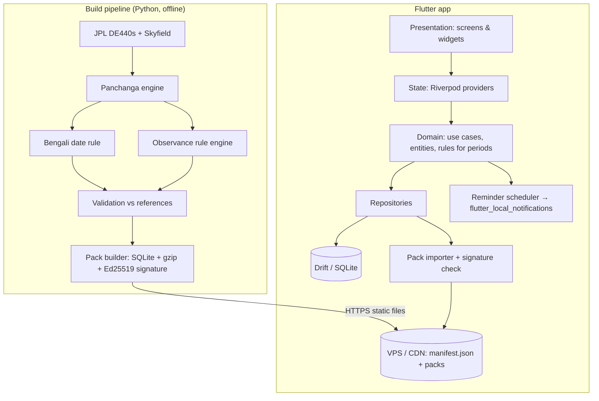

# Architecture

> Part of the Bangla Panjika spec. Section numbers (§) are permanent IDs shared by all docs; `docs/README.md` maps each one to its file.

## 14. Technical architecture

### 14.1 Layers



### 14.2 Folder structure (Flutter, inside `app/` of the monorepo)

```
lib/
  app/                    # MaterialApp, router, localisation setup
    theme/                # tokens (§12.2–12.8), PanjikaColors extension, per-locale TextThemes
  core/
    time/                 # IST helpers, panjika-day boundaries
    l10n/                 # PanjikaFormatter (dates, times, ranges, numerals, plurals), locale controller, search normaliser
    result/               # Result/Failure types
    flags/                # feature flags (bengal_periods, surya_siddhanta)
  domain/
    entities/             # BengaliDate, Tithi, Transition, DayPanjika, Observance, City
    engine/               # interfaces: PanjikaSource, PeriodCalculator, BengaliDateResolver
    usecases/             # GetDayPanjika, GetMonthGrid, GetUpcomingObservances, ScheduleReminders
  data/
    db/                   # Drift tables, DAOs, migrations
    packs/                # manifest client, downloader, signature verifier, importer
    repositories/         # implementations of domain interfaces
    fixtures/             # SAMPLE data, compiled only in debug/test, watermarked
  features/
    onboarding/ today/ calendar/ day/ festivals/ city/ reminders/ search/ settings/ sources/
  l10n/                   # app_bn.arb, app_en.arb
test/
  domain/ data/ widget/ golden/ fixtures/
integration_test/
```

### 14.3 Package choices (verify versions with `flutter pub outdated` at project start)

| Need | Package | Why | Watch-outs |
|---|---|---|---|
| State | `flutter_riverpod` | Testable, no BuildContext coupling, good for derived state (now → active period) | 3.x is the stable line (released Sep 2025); start on 3.x unless a code generator we need lags behind |
| Localisation | `flutter_localizations` (SDK) + `intl` + `gen-l10n` | Official ARB pipeline, ICU plural/select, type-safe accessors | `intl` version is pinned by the Flutter SDK; use `intl` for plural rules only, formatting goes through `PanjikaFormatter` (§13.3) |
| Local DB | `drift` + `drift_flutter` (pulls `sqlite3` 3.x, which bundles SQLite) | Typed SQL, migrations, reactive queries, packs are already SQLite | `sqlite3_flutter_libs` is end-of-life (replaced by `sqlite3` 3.x). One project reported Android release builds missing `libsqlite3.so` after drift 2.32 — verify the release APK on a device before shipping |
| Routing | `go_router` | Declarative, deep links for festival share links | — |
| Notifications | `flutter_local_notifications` + `timezone` | Mature, local scheduling | Android 13+ runtime permission; exact alarms restricted on Android 14+ (§17) |
| Location | `geolocator` (coarse) | Permission flow helpers | Request only on tap |
| HTTP | `dio` or `http` | Pack downloads with resume | — |
| Signatures | `cryptography` (Ed25519) | Verify packs | Pin the public key in code |
| Images for share | `RepaintBoundary` → PNG + `share_plus` | No extra rendering deps | — |
| Ads | `google_mobile_ads` + UMP consent | AdMob | Consent for EEA/UK users |
| IAP | `in_app_purchase` | Remove-ads | Restore purchases flow |
| Crash reporting | Sentry or Firebase Crashlytics (choose one) | Only if justified; Crashlytics brings Firebase | Disclose in Data safety |

No backend server is required for MVP: static files on your VPS/CDN cover packs, manifest and notices. Error reports can go to a tiny endpoint or a form service (Q6).

### 14.4 Data flow for "open Today"

1. `TodayScreen` watches `dayPanjikaProvider(today, cityId)`.
2. Provider calls `GetDayPanjika` → `PanjikaRepository.dayPanjika(date, city, tradition)`.
3. Repository reads from Drift: transitions overlapping the panjika day (sunrise→next sunrise), city rise/set row, Bengali date row, observance rows.
4. Domain computes periods (Rahu Kaal etc.) from sunrise/sunset + rule tables.
5. A `clockProvider` ticks each minute and on next transition time; derived providers recompute "active period" and "current tithi".

---

## 17. Notifications & reminders

- Android 13+: request `POST_NOTIFICATIONS` only when the user enables a reminder.
- Exact alarms: Android 14+ does not grant `SCHEDULE_EXACT_ALARM` by default to new installs. Default to **inexact** scheduling (a few minutes' variance is acceptable for "day before" reminders). Offer exact timing for tithi-start reminders only if granted. Check whether Play policy allows `USE_EXACT_ALARM` for a calendar app before declaring it (Q7).
- Reschedule triggers: app start, pack import, city/tradition change, `BOOT_COMPLETED`, time-zone change.
- Cap: 64 pending notifications (keeps iOS-compatible limits later).
- Channel names in the UI language: "উৎসব অনুস্মারক" / "Festival reminders", "তিথি অনুস্মারক" / "Tithi reminders". Channel IDs stay fixed; on a language change the channels are re-registered under the same IDs so Android shows the new names.
- Notification texts are generated at scheduling time in the UI language, so a language change triggers a reschedule (§16).

---

## 18. Offline & sync

- First launch works fully offline using bundled packs (current + next 2 Bengali years for global data; cities in West Bengal + 10 metros).
- Background: none. The manifest is checked on app open at most once per 24 h on Wi-Fi or mobile data.
- If a newer pack exists: download silently if < 2 MB, else ask.
- Corrections: a correction pack replaces only affected rows; the Day screen shows "সংশোধিত" (corrected) for 7 days on changed observances.

---

## 28. Repository

### 28.1 Repository layout (monorepo)

```
panjika/
  CLAUDE.md                 # agent rules (short; points here)
  docs/
    PRD.md                  # this document
    decisions/              # ADR-001-tradition.md, ADR-002-ephemeris.md …
    dependencies.md         # every package: version, licence, why
    assets.md               # source + licence of every image/icon
    phases/                 # build plan: one file per phase, status + log in phases/README.md
    spec/                   # technical detail by topic (this file is one of them)
    design/                 # visual concepts and approved screen designs (§12.12)
  data/                     # Python pipeline (§6.4)
  app/                      # Flutter app (§14.2)
  .github/workflows/        # ci-data.yml, ci-app.yml
```

`data/` and `app/` share nothing at build time except the pack files and the schema (§15). The schema is defined once in `data/pack/schema.sql` and mirrored by Drift tables in `app/lib/data/db/`; a test in each side checks the column list matches.
